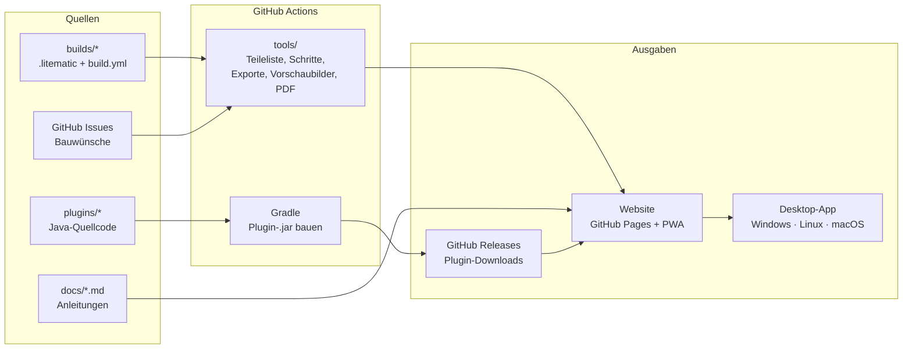

# Masterplan: minecraft-tools

Arbeitstitel: **Savox Bauwerkstatt**. Eine Sammlung von Minecraft-Bauanleitungen und Server-Plugins für Kreative, kostenlos und einzeln herunterladbar.

Stand: 01.11.2026 · Status: Entwurf zur Abstimmung

---

## 1. Ziel

- **Alle Baupläne** (Türme, Villen, Farmen, Technik) als Schritt-für-Schritt-Anleitungen im **LEGO-Stil**: Zu jedem Schritt ist sofort klar, welche Blöcke in welcher Menge gebraucht werden.
- **Alle eigenen Plugins** mit Quellcode, Doku und Download.
- **Jeder Bauplan und jedes Plugin einzeln** verfügbar, ohne Gesamtpaket.
- **Gleiche Oberfläche** auf Windows, Linux und macOS.
- **Wünsche für neue Anleitungen** einreichen und abstimmen.

## 2. Empfehlung in Kürze

**Eine Codebasis, drei Ausgaben:**

| Ausgabe | Wofür | Kosten |
|---|---|---|
| **Website auf GitHub Pages** | Hauptweg. Läuft in jedem Browser auf jedem System, kein Installieren | kostenlos |
| **Offline-App (PWA)** | Dieselbe Website lässt sich mit einem Klick „installieren“ und läuft dann ohne Internet | kostenlos |
| **Desktop-App (Tauri)** | Gleiche Oberfläche plus Funktionen, die eine Website nicht kann: Baupläne direkt in den Minecraft-Ordner kopieren, Plugins mit Backup in einen Server installieren | kostenlos, Installer werden automatisch für alle 3 Systeme gebaut |

**Kann das dauerhaft auf GitHub Pages bleiben? Ja.** Das Repo ist öffentlich, und die Seite ist rein statisch, braucht also keinen eigenen Server. Die Grenzen von GitHub Pages liegen bei 1 GB Seitengröße und etwa 100 GB Datenverkehr pro Monat. Für Baupläne und Plugin-Dateien reicht das weit. Nicht erlaubt ist nur Pages als Hosting für einen Shop oder ein Geschäft. Eine kostenlose Sammlung ist in Ordnung.

**Reihenfolge:** Erst die Website mit Offline-Funktion, denn sie deckt Windows, Linux und macOS schon vollständig ab. Die Desktop-App kommt danach, sobald die lokalen Zusatzfunktionen gebraucht werden.

---

## 3. Was hinein soll (Bestand)

### Baupläne (8)

| ID | Name | Größe | Höhe | Blöcke ca. |
|---|---|---|---|---|
| `eiffelturm` | Eiffelturm (1:3) | 43 × 43 | 112 | 7.600 |
| `leuchtturm` | Leuchtturm | Ø 17 | 65 | 2.600 |
| `villa-am-wasser` | Villa am Wasser mit Pool und Wasser-Aufzug | 27 × 27 | 15 | 2.700 |
| `villa-modern` | Moderne Villa | 29 × 23 | 12 | 2.000 |
| `villa-mediterran` | Mediterrane Villa | 27 × 27 | 16 | 3.750 |
| `villa-gruenderzeit` | Gründerzeit-Villa mit Turm | 21 × 15 + Turm | 38 | 2.750 |
| `gewaechshaus-farm` | Gewächshaus mit Dorfbewohner-Farm | 15 × 15 | 14 | 870 |
| `kellerlager` | Kellerlager mit Sortieranlage (Java) | 17 × 12 | 8 | 800 |

Quelle: die bisherige Bauplan-Seite (Claude-Artifact „Spawn-Baupläne“).

### Eigene Plugins (7, Paper)

| Plugin | Version | Kurz |
|---|---|---|
| AdminLogin | 1.2.0 | Admin-Passwort beim Betreten, SuperOP, Sperre nach Fehlversuchen |
| ServerShop | 1.4.0 | Coin-Shop, Spieler-Shops, Tageslimits |
| InfiniteLager | 3.2.0 | gemeinsames und privates Lager, Einlagern-Truhen, Protokoll |
| ProvokedMobs | 1.2.0 | Creeper-Schutz, umschaltbar |
| Arbeiter | 2.0.1 | Dorfbewohner-Arbeiter mit 11 Berufen, Händler |
| ServerEinstellungen | 1.2.0 | Server-Einstellungen per Chatbefehl, SuperOP-Rechte |
| ServerHilfe | 1.0.0 | Hilfe-Buch und `/hilfe`-Menü |

Quelle: der Ordner „Quellcode“ aus dem Server-Update-Paket.

### Anleitungen ohne Bauplan

- Farm-Bot mit FakePlayerPlugin (Paper)
- Spieler-Aktionen protokollieren mit CoreProtect
- Server-Update installieren

---

## 4. Das LEGO-Prinzip

So sieht eine Bauanleitung aus:

1. **Deckblatt:** Bild des fertigen Bauwerks, Name, Größe, Schwierigkeit, Bauzeit, Java/Bedrock.
2. **Gesamt-Teileliste:** alle Blöcke mit Bild und Anzahl, zusätzlich in Stacks (z. B. „12 St. + 30“). Darunter die Rohstoffe aus Farmen, zum Beispiel „1.050 Sand = Glas und Beton“.
3. **Bauschritte, nummeriert, einer pro Seite:**
   - oben links die Schrittnummer, groß
   - ein Kasten **„Neue Teile in diesem Schritt“** mit Block-Bildern und „× 12“, wie bei LEGO
   - eine 3D-Ansicht: neue Blöcke kräftig, bereits gebaute blass, Nordpfeil
   - bei Treppen, Stufen, Türen und Trichtern ein **Richtungs-Hinweis** (Pfeil), denn dort passieren die meisten Fehler
   - optionale Tipp-Kästen („Erst Seetang wachsen lassen, dann abbauen“)
4. **Unterbaugruppen** wie bei LEGO: Teile, die mehrfach vorkommen (Palme, Fenster-Modul, Laternenpfahl), werden einmal gezeigt und mit **„2 ד** markiert.
5. **Schritt-Regeln:** höchstens etwa 60 neue Blöcke pro Schritt. Große Ebenen werden in Abschnitte geteilt (zuerst Ecken und Rahmen, dann Flächen, dann Details). Die Schritte entstehen automatisch, und von Hand lässt sich nachsteuern.
6. **Ausgaben pro Bauplan:**
   - Web-Ansicht zum Durchblättern, auf dem Handy wischbar
   - druckbares **PDF-Heft** im selben Look
   - Teileliste als **CSV**
   - Bauplan-Dateien zum direkten Einfügen ins Spiel (siehe 6.)
7. **Baufortschritt:** Erledigte Schritte lassen sich abhaken. Der Stand wird im Browser gespeichert.

**Wichtige Änderung gegenüber heute:** Die bisherigen Modelle kennen keine **Blockrichtungen** (wohin eine Treppe zeigt, obere oder untere Stufe). Für echte LEGO-Genauigkeit wird jeder Bau einmal in einer Kreativ-Testwelt nachgebaut oder geprüft und als `.litematic` exportiert. Diese Datei ist ab dann die Quelle für alles andere. Dabei wird jeder Bauplan automatisch einmal real getestet.

---

## 5. Architektur



**Technik-Entscheidungen**

| Teil | Wahl | Warum |
|---|---|---|
| Website | Vite + TypeScript + Svelte | klein, schnell, eine Oberfläche für Web und Desktop |
| 3D-Ansicht | Three.js mit Instancing | Zehntausende Blöcke flüssig, drehbar, Schritte ein- und ausblenden |
| Bauplan-Pipeline | Python (`litemapy`, `nbtlib`) | liest und schreibt `.litematic`, `.schem`, `.nbt` und Bedrock-`.mcstructure` |
| PDF-Heft | Playwright druckt die Schritt-Seiten | PDF sieht genau aus wie die Website |
| Desktop | Tauri 2 | kleine Installer (etwa 10 MB statt 100 MB bei Electron), gleiche Oberfläche |
| Plugins | Gradle-Multiprojekt, Paper-API, Java 21 | ein Befehl baut alle 7, jedes einzeln versioniert |
| Wünsche | GitHub-Issue-Formulare | kein eigener Server nötig, Abstimmung per 👍 |
| Sprachen | Deutsch zuerst, Englisch danach | Sprachdateien als JSON |

---

## 6. Downloads pro Eintrag

**Pro Bauplan**

| Datei | Für wen |
|---|---|
| `.litematic` | Java mit Litematica-Mod: Bauplan als Geisterblöcke im Spiel |
| `.schem` | WorldEdit oder FastAsyncWorldEdit auf Servern |
| `.nbt` | Strukturblock in Vanilla Java (bis 48 × 48 × 48, größere werden geteilt) |
| `.mcstructure` | Bedrock (Strukturblock) |
| `anleitung.pdf` | Ausdrucken, Tablet |
| `teileliste.csv` | Excel und Co. |

**Pro Plugin**
- `.jar` aus GitHub Releases. Jedes Plugin hat eigene Tags, z. B. `arbeiter-v2.0.1`.
- `README` mit Befehlen, Rechten und `config.yml` erklärt.
- Changelog.
- Getestete Paper-Version.

Jede Detailseite hat einen eigenen, teilbaren Link, etwa `…/#/bau/leuchtturm` oder `…/#/plugin/arbeiter`.

---

## 7. Repo-Struktur

```
minecraft-tools/
├─ MASTERPLAN.md
├─ README.md                  Einstieg, Disclaimer, Links
├─ LICENSE-CODE               Lizenz für Code und Plugins
├─ LICENSE-CONTENT            Lizenz für Baupläne und Texte
├─ builds/
│  └─ leuchtturm/
│     ├─ build.yml            Name, Beschreibung, Tags, Schritte-Overrides, Tipps
│     ├─ leuchtturm.litematic Quelle der Wahrheit
│     └─ README.md            optional: Hintergrund, Varianten
├─ plugins/
│  ├─ settings.gradle.kts
│  ├─ arbeiter/               src/, README.md, CHANGELOG.md, build.gradle.kts
│  └─ …
├─ docs/                      Anleitungen (Farm-Bot, CoreProtect, Server-Update)
├─ tools/                     Python-Pipeline: Import, Teileliste, Schritte, Exporte, PDF
├─ app/                       Website (Vite + Svelte + Three.js)
├─ desktop/                   Tauri-Hülle um app/
└─ .github/
   ├─ workflows/              pages.yml, plugins.yml, desktop.yml, check.yml
   └─ ISSUE_TEMPLATE/         bauwunsch.yml, plugin-wunsch.yml, fehler.yml
```

### Beispiel `build.yml`

```yaml
id: leuchtturm
titel: { de: Leuchtturm, en: Lighthouse }
beschreibung: { de: "Rot-weißer Leuchtturm mit Umgang und Leuchtfeuer, innen begehbar." }
kategorie: tuerme
tags: [wasser, spawn, wahrzeichen]
edition: [java, bedrock]
schwierigkeit: 2          # 1 = leicht … 5 = Profi
bauzeit_stunden: [5, 8]
quelle: leuchtturm.litematic
schritte:
  max_neue_bloecke: 60
  gruppen:                 # optional: Ebenen von Hand zusammenfassen
    - { name: Fundament, ebenen: [0, 0] }
    - { name: Sockelraum, ebenen: [1, 4] }
unterbaugruppen: []
tipps:
  - schritt: 12
    text: { de: "Beton: 4 Sand + 4 Kies + 1 Farbstoff = 8 Pulver, dann ins Wasser." }
autor: Savox
version: 1.0.0
```

---

## 8. Phasenplan

Aufwand in **Arbeitssitzungen** (eine Sitzung = ein Abend gemeinsam mit Claude).

### Phase 0 · Fundament (1 Sitzung)
- [ ] Lizenzen festlegen und Dateien anlegen (siehe 10.)
- [ ] README mit Disclaimer: „Kein offizielles Minecraft-Produkt …“
- [ ] Repo-Ordner wie in 7. anlegen
- [ ] Issue-Formulare: Bauwunsch, Plugin-Wunsch, Fehler melden
- [ ] GitHub Pages aktivieren (Quelle: GitHub Actions)

**Fertig, wenn:** Eine leere Seite unter `savox76.github.io/minecraft-tools` erreichbar ist und ein Bauwunsch als Issue eingereicht werden kann.

### Phase 1 · Bauplan-Pipeline (2–3 Sitzungen)
- [ ] `tools/import`: `.litematic` einlesen, inklusive Blockrichtungen
- [ ] Teileliste und Rohstoff-Rechner (Rezepte aus den bisherigen Modellen übernehmen)
- [ ] Automatische Schritt-Aufteilung nach den LEGO-Regeln aus 4.
- [ ] Exporte: `.schem`, `.nbt`, `.mcstructure`, `teileliste.csv`
- [ ] Vorschaubilder (Deckblatt, Schritt-Bilder) als PNG
- [ ] Check-Workflow: Jeder Bauplan muss fehlerfrei durchlaufen
- [ ] **Migration:** die 8 bisherigen Modelle als Rohfassung exportieren, in der Kreativ-Testwelt richten (Treppen, Türen) und als `.litematic` zurück ins Repo

**Fertig, wenn:** Der Leuchtturm vollständig mit allen Exporten durchläuft und im Spiel per Litematica korrekt erscheint.

### Phase 2 · Website (3–4 Sitzungen)
- [ ] Katalog: Kacheln mit Vorschaubild, Filter nach Kategorie, Größe, Schwierigkeit, Edition
- [ ] Bauplan-Seite: Deckblatt, Teileliste, Schritt-Ansicht im LEGO-Stil, 3D drehbar, Ebenen-Ansicht wie bisher, Download-Knöpfe
- [ ] Baufortschritt abhaken, gespeichert im Browser
- [ ] Koordinaten-Helfer (wie bisher): Mitte eintragen, echte X/Y/Z pro Block
- [ ] Plugin-Seiten: Beschreibung, Befehle, Rechte, Config, Download der neuesten Version
- [ ] Anleitungs-Seiten aus `docs/`
- [ ] Wunschliste: offene Bauwünsche, sortiert nach 👍
- [ ] PWA: installierbar und offline nutzbar
- [ ] Hell- und Dunkelmodus, Handy-tauglich

**Fertig, wenn:** Alle 8 Baupläne, 7 Plugins und 3 Anleitungen online sind und jede Seite einen eigenen Link hat.

### Phase 3 · LEGO-PDF-Hefte (1 Sitzung)
- [ ] Druck-Layout für Deckblatt, Teileliste, Schritte (2 pro Seite bei kleinen Schritten)
- [ ] Automatisch bei jeder Änderung neu erzeugen und zum Download anbieten

### Phase 4 · Plugins ins Repo (2–3 Sitzungen)
- [ ] Quellcode der 7 Plugins übernehmen, Gradle-Multiprojekt
- [ ] **Sicherheits-Check vor dem Hochladen:** keine Passwörter, Server-IPs, playit-Adressen oder persönlichen Spielernamen im Code oder in Standard-Configs
- [ ] Texte auslagern, damit sie übersetzbar sind (Deutsch und Englisch)
- [ ] Pro Plugin: README (Befehle, Rechte, Config), CHANGELOG
- [ ] Workflow: Ein Tag `<plugin>-v<version>` baut die `.jar` und hängt sie an ein Release
- [ ] Optional: zusätzlich auf Modrinth und Hangar veröffentlichen

**Fertig, wenn:** Jedes Plugin einzeln über die Website als `.jar` herunterladbar ist.

### Phase 5 · Desktop-App (2 Sitzungen)
- [ ] Tauri-Hülle um dieselbe Website
- [ ] Lokale Zusatzfunktionen:
  - „In Minecraft öffnen“: kopiert `.litematic` in `.minecraft/schematics`
  - „In Server installieren“: Server-Ordner wählen, Plugin kopieren, vorher Backup (wie heute `INSTALLIEREN.bat`)
  - Offline-Gesamtpaket aller Baupläne
- [ ] Workflow: Installer für Windows (`.msi`), macOS (`.dmg`) und Linux (`.AppImage`, `.deb`) bei jedem Release
- [ ] Hinweis für Nutzer: Ohne kostenpflichtige Code-Signatur zeigen Windows („Der Computer wurde geschützt“) und macOS beim ersten Start eine Warnung

### Phase 6 · Community (1 Sitzung, danach laufend)
- [ ] `CONTRIBUTING.md`: So reicht man einen eigenen Bauplan ein (`.litematic` + `build.yml` per Pull Request)
- [ ] Automatische Prüfung eingereichter Baupläne
- [ ] Wunsch-Ablauf: Issue → Label `angenommen` → in Arbeit → fertig, dann automatisch mit dem neuen Bauplan verlinkt

---

## 9. Bauwünsche

1. Auf der Website auf **„Bauplan wünschen“** klicken. Das öffnet ein GitHub-Formular mit den Feldern Name des Bauwerks, Stil, ungefähre Größe, Java/Bedrock, Referenzbilder und gewünschte Rohstoffe.
2. Andere stimmen mit **👍** ab.
3. Einmal pro Tag holt ein Workflow die offenen Wünsche und schreibt sie als Datei in die Website. Besucher brauchen dafür kein GitHub-Konto und die Seite keine Live-Abfrage.
4. Zum Einreichen braucht man ein kostenloses GitHub-Konto. Ein Formular ohne Konto ginge nur mit einem Zusatzdienst, das ist eine spätere Option.

---

## 10. Rechtliches und Sicherheit

- **Kein Minecraft-Material verbreiten:** keine Original-Texturen, Sounds oder das Logo im Repo. Die Blöcke werden wie bisher mit eigenen Farben dargestellt. In der Desktop-App kann jeder optional sein **eigenes** Ressourcenpaket laden, das dann nur lokal genutzt wird.
- **Disclaimer** auf jeder Seite: „Kein offizielles Minecraft-Produkt. Nicht von Mojang oder Microsoft genehmigt oder mit ihnen verbunden.“ Das Tool darf nicht offiziell wirken.
- **Kostenlos:** Die Minecraft-EULA verbietet, mit Mods oder Inhalten Geld zu verdienen. Alles bleibt also gratis.
- **Lizenz-Vorschlag:**
  - Code und Plugins: **MIT** (jeder darf nutzen und ändern, Namensnennung bleibt)
  - Baupläne und Texte: **CC BY 4.0** (frei nutzbar mit Namensnennung) oder **CC BY-NC 4.0** (zusätzlich keine kommerzielle Nutzung durch andere)
- **Plugins:** Vor jeder Veröffentlichung auf Passwörter und Adressen prüfen (siehe Phase 4). AdminLogin speichert Passwörter verschlüsselt, das bleibt so.
- **Datenschutz:** Die Website setzt keine Cookies und kein Tracking. Der Baufortschritt bleibt nur im Browser des Nutzers.
- **Impressum:** Ob eine private, kostenlose Seite ein Impressum braucht, hängt davon ab, ob sie als geschäftsmäßig gilt, etwa durch eine Verbindung zur Marke Savox. Das vor dem Start kurz prüfen. Ich bin kein Anwalt.

---

## 11. Ideen für später

- **Ingame-Plugin „BauHelfer“:** zeigt den aktuellen Bauschritt als Geisterblöcke direkt auf dem Server, prüft, ob alles richtig gesetzt ist, und hakt den Schritt ab. Funktioniert ohne Mod, also auch für Bedrock-Spieler.
- **Shop-Preisrechner:** Was kostet ein Bauplan in Coins im eigenen ServerShop?
- **Farm-Planer:** Welche Farmen braucht ein Bauplan, und wie lange dauert das Sammeln?
- **Lageplan-Editor:** mehrere Baupläne plus Farm-Bot-Radius auf einer Karte anordnen
- **Zeitraffer-Animation:** jeder Bauplan als kurzes Video oder GIF, Schritt für Schritt
- **Varianten:** Größen (1:1, 1:2) und Materialvarianten (Holz- oder Steinversion) per Klick
- **Bauplan-Pakete:** zusammengehörige Pläne gebündelt, z. B. „Villa am Wasser + Kellerlager + Gewächshaus“
- **Server-Setup-Assistent:** Paper, Plugins, Bot und Einstellungen in einem geführten Ablauf (Desktop-App)

---

## 12. Offene Entscheidungen

| # | Frage | Mein Vorschlag |
|---|---|---|
| 1 | Name des Projekts | „Savox Bauwerkstatt“ |
| 2 | Lizenz Baupläne | CC BY-NC 4.0 |
| 3 | Lizenz Code und Plugins | MIT |
| 4 | Sprachen | Deutsch und Englisch (Englisch ab Phase 2) |
| 5 | Plugin-Quellcode öffentlich? | Ja, nach dem Sicherheits-Check |
| 6 | Bedrock-Export (`.mcstructure`) | Ja, weil dein Server Bedrock-Spieler hat |
| 7 | Desktop-App sofort oder später? | Später (Phase 5), die Website deckt erst einmal alles ab |
| 8 | Eigene Domain statt `savox76.github.io/minecraft-tools`? | Optional, auch später möglich (ca. 10 €/Jahr) |

---

## 13. Nächster Schritt

Entscheidungen aus Abschnitt 12 treffen, danach **Phase 0** umsetzen. Parallel kannst du schon einmal den Leuchtturm in einer Kreativ-Testwelt bauen und als `.litematic` exportieren. Er wird der erste vollständige Bauplan in der Pipeline.
