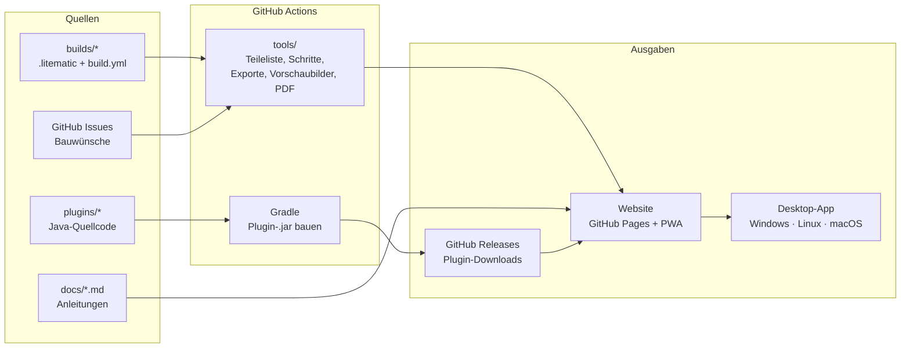

# Masterplan: minecraft-tools

Arbeitstitel: **Savox Bauwerkstatt**. Eine Sammlung von Minecraft-Bauanleitungen und Server-Plugins für Kreative, kostenlos und einzeln herunterladbar.

Stand: 01.11.2026 · Website: <https://savox76.github.io/minecraft-tools/>

---

## 0. Aktueller Stand

| Bereich | Status | Wo |
|---|---|---|
| 8 Baupläne | ✅ **verfügbar** als Entwurf: LEGO-Schritte, Teileliste, `.litematic`, `.schem`, CSV | [`builds/`](builds/) |
| 7 eigene Plugins | 🟡 **Doku verfügbar**, Quellcode und `.jar` integrierbar, sobald der Quellcode vorliegt | [`plugins/eigene/`](plugins/eigene/) |
| Fremde Plugins | 🟡 **vorläufige Liste** (7) aus den Server-Notizen, wird mit der vollständigen Liste ergänzt | [`plugins/fremd/plugins.json`](plugins/fremd/plugins.json) |
| 2 Anleitungen | ✅ verfügbar (Farm-Bot, CoreProtect) | [`docs/`](docs/) |
| Website | ✅ automatisch per GitHub Actions auf GitHub Pages, **Deutsch und Englisch**, Hell/Dunkel/Automatisch, suchmaschinenfreundlich (siehe 14.) | [`site/`](site/), [`tools/build_site.py`](tools/build_site.py), [`tools/seiten.py`](tools/seiten.py) |
| Bauwünsche | ✅ Issue-Formulare, Wunschliste täglich auf der Website | [`.github/ISSUE_TEMPLATE/`](.github/ISSUE_TEMPLATE/) |

**Entwurf** heißt: Die Richtung von Treppen, Türen und Trichtern ist in den Dateien noch nicht in einer Testwelt geprüft (siehe Phase 1).

### Feste Regeln

- **Jeder neue Bauplan kommt ins Repo** als Ordner `builds/<id>/` (Format in [`builds/README.md`](builds/README.md)). Website, LEGO-Schritte, Teileliste und Downloads entstehen daraus automatisch. Er erscheint also überall, ohne dass sonst etwas angepasst werden muss.
- **Eigene und fremde Plugins bleiben getrennt.** Eigene Plugins bekommen `plugins/eigene/<id>/plugin.json` und `README.md`, fremde einen Eintrag in `plugins/fremd/plugins.json` (nur Beschreibung, Einsatz und Link zur offiziellen Seite, keine Dateien). Die Website zeigt beides automatisch in getrennten Bereichen.
- **Änderungen gehen direkt auf `main`.**
- **Alles zweisprachig:** Neue Baupläne, Plugins und Anleitungen bekommen eine englische Fassung (`"en"` in `build.json` und `plugin.json`, `docs/en/<id>.md`, neue Blocknamen in `tools/i18n/bloecke_en.json`). Fehlt sie, zeigt die englische Seite den deutschen Text und der Build gibt einen Hinweis aus.
- **Keine erzeugten Dateien im Repo:** Website, `.litematic`, `.schem`, `.jar` und PDFs baut GitHub Actions bei jedem Push neu.

---

## 1. Ziel

- **Alle Baupläne** (Türme, Villen, Farmen, Technik) als Schritt-für-Schritt-Anleitungen im **LEGO-Stil**: Zu jedem Schritt ist sofort klar, welche Blöcke in welcher Menge gebraucht werden.
- **Alle eigenen Plugins** mit Quellcode, Doku und Download.
- **Jeder Bauplan und jedes Plugin einzeln** verfügbar, ohne Gesamtpaket.
- **Gleiche Oberfläche** auf Windows, Linux und macOS.
- **Wünsche für neue Anleitungen** einreichen und abstimmen.

## 2. Empfehlung in Kürze

**Eine Codebasis, drei Ausgaben:**

| Ausgabe | Wofür | Kosten |
|---|---|---|
| **Website auf GitHub Pages** | Hauptweg. Läuft in jedem Browser auf jedem System, kein Installieren | kostenlos |
| **Offline-App (PWA)** | Dieselbe Website lässt sich mit einem Klick „installieren“ und läuft dann ohne Internet | kostenlos |
| **Desktop-App (Tauri)** | Gleiche Oberfläche plus Funktionen, die eine Website nicht kann: Baupläne direkt in den Minecraft-Ordner kopieren, Plugins mit Backup in einen Server installieren | kostenlos, Installer werden automatisch für alle 3 Systeme gebaut |

**Kann das dauerhaft auf GitHub Pages bleiben? Ja.** Das Repo ist öffentlich, und die Seite ist rein statisch, braucht also keinen eigenen Server. Die Grenzen von GitHub Pages liegen bei 1 GB Seitengröße und etwa 100 GB Datenverkehr pro Monat. Für Baupläne und Plugin-Dateien reicht das weit. Nicht erlaubt ist nur Pages als Hosting für einen Shop oder ein Geschäft. Eine kostenlose Sammlung ist in Ordnung.

**Reihenfolge:** Erst die Website mit Offline-Funktion, denn sie deckt Windows, Linux und macOS schon vollständig ab. Die Desktop-App kommt danach, sobald die lokalen Zusatzfunktionen gebraucht werden.

---

## 3. Was hinein soll (Bestand)

### Baupläne (8)

| ID | Name | Größe | Höhe | Blöcke ca. |
|---|---|---|---|---|
| `eiffelturm` | Eiffelturm (1:3) | 43 × 43 | 112 | 7.600 |
| `leuchtturm` | Leuchtturm | Ø 17 | 65 | 2.600 |
| `villa-am-wasser` | Villa am Wasser mit Pool und Wasser-Aufzug | 27 × 27 | 15 | 2.700 |
| `villa-modern` | Moderne Villa | 29 × 23 | 12 | 2.000 |
| `villa-mediterran` | Mediterrane Villa | 27 × 27 | 16 | 3.750 |
| `villa-gruenderzeit` | Gründerzeit-Villa mit Turm | 21 × 15 + Turm | 38 | 2.750 |
| `gewaechshaus-farm` | Gewächshaus mit Dorfbewohner-Farm | 15 × 15 | 14 | 870 |
| `kellerlager` | Kellerlager mit Sortieranlage (Java) | 17 × 12 | 8 | 800 |

Quelle: die bisherige Bauplan-Seite (Claude-Artifact „Spawn-Baupläne“).

### Eigene Plugins (7, Paper)

| Plugin | Version | Kurz |
|---|---|---|
| AdminLogin | 1.2.0 | Admin-Passwort beim Betreten, SuperOP, Sperre nach Fehlversuchen |
| ServerShop | 1.4.0 | Coin-Shop, Spieler-Shops, Tageslimits |
| InfiniteLager | 3.2.0 | gemeinsames und privates Lager, Einlagern-Truhen, Protokoll |
| ProvokedMobs | 1.2.0 | Creeper-Schutz, umschaltbar |
| Arbeiter | 2.0.1 | Dorfbewohner-Arbeiter mit 11 Berufen, Händler |
| ServerEinstellungen | 1.2.0 | Server-Einstellungen per Chatbefehl, SuperOP-Rechte |
| ServerHilfe | 1.0.0 | Hilfe-Buch und `/hilfe`-Menü |

Quelle: der Ordner „Quellcode“ aus dem Server-Update-Paket.

### Fremde Plugins (vorläufig)

FakePlayerPlugin, ChunkLoader, EasyCommandBlocker, Simple Voice Chat, Floodgate, spark (im Einsatz) und CoreProtect (empfohlen). Die vollständige Liste folgt.

### Anleitungen ohne Bauplan

- Farm-Bot mit FakePlayerPlugin (Paper)
- Spieler-Aktionen protokollieren mit CoreProtect

---

## 4. Das LEGO-Prinzip

So sieht eine Bauanleitung aus:

1. **Deckblatt:** Bild des fertigen Bauwerks, Name, Größe, Schwierigkeit, Bauzeit, Java/Bedrock.
2. **Gesamt-Teileliste:** alle Blöcke mit Bild und Anzahl, zusätzlich in Stacks (z. B. „12 St. + 30“). Darunter die Rohstoffe aus Farmen, zum Beispiel „1.050 Sand = Glas und Beton“.
3. **Bauschritte, nummeriert, einer pro Seite:**
   - oben links die Schrittnummer, groß
   - ein Kasten **„Neue Teile in diesem Schritt“** mit Block-Bildern und „× 12“, wie bei LEGO
   - eine 3D-Ansicht: neue Blöcke kräftig, bereits gebaute blass, Nordpfeil
   - bei Treppen, Stufen, Türen und Trichtern ein **Richtungs-Hinweis** (Pfeil), denn dort passieren die meisten Fehler
   - optionale Tipp-Kästen („Erst Seetang wachsen lassen, dann abbauen“)
4. **Unterbaugruppen** wie bei LEGO: Teile, die mehrfach vorkommen (Palme, Fenster-Modul, Laternenpfahl), werden einmal gezeigt und mit **„2 ד** markiert.
5. **Schritt-Regeln:** höchstens etwa 60 neue Blöcke pro Schritt. Große Ebenen werden in Abschnitte geteilt (zuerst Ecken und Rahmen, dann Flächen, dann Details). Die Schritte entstehen automatisch, und von Hand lässt sich nachsteuern.
6. **Ausgaben pro Bauplan:**
   - Web-Ansicht zum Durchblättern, auf dem Handy wischbar
   - druckbares **PDF-Heft** im selben Look
   - Teileliste als **CSV**
   - Bauplan-Dateien zum direkten Einfügen ins Spiel (siehe 6.)
7. **Baufortschritt:** Erledigte Schritte lassen sich abhaken. Der Stand wird im Browser gespeichert.

**Wichtige Änderung gegenüber heute:** Die bisherigen Modelle kennen keine **Blockrichtungen** (wohin eine Treppe zeigt, obere oder untere Stufe). Für echte LEGO-Genauigkeit wird jeder Bau einmal in einer Kreativ-Testwelt nachgebaut oder geprüft und als `.litematic` exportiert. Diese Datei ist ab dann die Quelle für alles andere. Dabei wird jeder Bauplan automatisch einmal real getestet.

---

## 5. Architektur



**Technik-Entscheidungen**

| Teil | Wahl | Warum |
|---|---|---|
| Website | HTML, CSS und JavaScript-Module ohne Build-Schritt | läuft sofort auf GitHub Pages, kein Node nötig, eine Oberfläche für Web und Desktop. Ein Umstieg auf Vite und Svelte bleibt möglich, falls die Seite stark wächst |
| 3D-Ansicht | eigene isometrische Canvas-Darstellung | leicht, zoomt pro Schritt auf das Gebaute, hebt neue Blöcke hervor. Three.js kommt erst dazu, wenn freies Drehen und Zoomen gebraucht wird |
| Bauplan-Pipeline | Python (`litemapy`, `nbtlib`, `Markdown`) | liest und schreibt `.litematic`, `.schem`, später auch `.nbt` und Bedrock-`.mcstructure` |
| PDF-Heft | Playwright druckt die Schritt-Seiten | PDF sieht genau aus wie die Website |
| Desktop | Tauri 2 | kleine Installer (etwa 10 MB statt 100 MB bei Electron), gleiche Oberfläche |
| Plugins | Gradle-Multiprojekt, Paper-API, Java 21 | ein Befehl baut alle 7, jedes einzeln versioniert |
| Wünsche | GitHub-Issue-Formulare | kein eigener Server nötig, Abstimmung per 👍 |
| Sprachen | Deutsch und Englisch | `"en"` in den JSON-Dateien, `docs/en/`, `tools/i18n/` |

---

## 6. Downloads pro Eintrag

**Pro Bauplan**

| Datei | Für wen |
|---|---|
| `.litematic` | Java mit Litematica-Mod: Bauplan als Geisterblöcke im Spiel |
| `.schem` | WorldEdit oder FastAsyncWorldEdit auf Servern |
| `.nbt` | Strukturblock in Vanilla Java (bis 48 × 48 × 48, größere werden geteilt) |
| `.mcstructure` | Bedrock (Strukturblock) |
| `anleitung.pdf` | Ausdrucken, Tablet |
| `teileliste.csv` | Excel und Co. |

**Pro Plugin**
- `.jar` aus GitHub Releases. Jedes Plugin hat eigene Tags, z. B. `arbeiter-v2.0.1`.
- `README` mit Befehlen, Rechten und `config.yml` erklärt.
- Changelog.
- Getestete Paper-Version.

Jede Detailseite hat einen eigenen, teilbaren Link, etwa `…/#/bau/leuchtturm` oder `…/#/plugin/arbeiter`.

---

## 7. Repo-Struktur

```
minecraft-tools/
├─ MASTERPLAN.md
├─ README.md                  Einstieg, Disclaimer, Links
├─ LICENSE-CODE               Lizenz für Code und Plugins
├─ LICENSE-CONTENT            Lizenz für Baupläne und Texte
├─ builds/
│  └─ leuchtturm/
│     ├─ build.yml            Name, Beschreibung, Tags, Schritte-Overrides, Tipps
│     ├─ leuchtturm.litematic Quelle der Wahrheit
│     └─ README.md            optional: Hintergrund, Varianten
├─ plugins/
│  ├─ eigene/
│  │  ├─ arbeiter/            plugin.json, README.md, später src/ und build.gradle.kts
│  │  └─ …
│  └─ fremd/plugins.json      Plugins anderer Entwickler: Zweck, Einsatz, Link
├─ docs/                      Anleitungen (Farm-Bot, CoreProtect)
├─ tools/                     build_site.py (Schritte, Teileliste, Exporte, Website-Daten), seiten.py (vorgerenderte Seiten,
│                             Vorschaubilder, Sitemap), fetch_wishes.py, site_config.json
├─ site/                      Website: index.html, style.css, js/app.js, js/render.js
├─ desktop/                   später: Tauri-Hülle um site/
└─ .github/
   ├─ workflows/              website.yml (heute), später plugins.yml, desktop.yml
   └─ ISSUE_TEMPLATE/         bauwunsch.yml, plugin-wunsch.yml, fehler.yml
```

### Format eines Bauplans

Heute besteht jeder Bauplan aus `build.json` (Beschreibung, Abschnitte, Tipps, Rohstoffe) und `model.json` (Blöcke mit Minecraft-ID, Ebene für Ebene). Alle Felder stehen in [`builds/README.md`](builds/README.md).

Ab Phase 1 kommt eine `.litematic`-Datei aus der Testwelt als Quelle dazu. `model.json` wird dann daraus erzeugt, inklusive Blockrichtungen.

---

## 8. Phasenplan

Aufwand in **Arbeitssitzungen** (eine Sitzung = ein Abend gemeinsam mit Claude).

### Phase 0 · Fundament (1 Sitzung)
- [ ] Lizenzen festlegen und Dateien anlegen (siehe 10.)
- [x] README mit Disclaimer: „Kein offizielles Minecraft-Produkt …“
- [x] Repo-Ordner wie in 7. anlegen
- [x] Issue-Formulare: Bauwunsch, Plugin-Wunsch, Fehler melden
- [x] Workflow für GitHub Pages (Quelle: GitHub Actions)

**Fertig, wenn:** Eine leere Seite unter `savox76.github.io/minecraft-tools` erreichbar ist und ein Bauwunsch als Issue eingereicht werden kann.

### Phase 1 · Bauplan-Pipeline (2–3 Sitzungen)
- [ ] `.litematic` einlesen, inklusive Blockrichtungen
- [x] Teileliste und Rohstoffe (aus den bisherigen Modellen übernommen)
- [x] Automatische Schritt-Aufteilung nach den LEGO-Regeln aus 4.
- [x] Exporte: `.litematic`, `.schem`, `teileliste.csv`
- [ ] Exporte: `.nbt`, `.mcstructure`
- [x] Vorschaubilder (werden im Browser gezeichnet)
- [x] Check: Jeder Bauplan muss im Workflow fehlerfrei durchlaufen, auch bei Pull Requests
- [x] **Migration:** die 8 bisherigen Modelle sind als Entwurf im Repo
- [ ] In der Kreativ-Testwelt richten (Treppen, Türen) und als `.litematic` zurück ins Repo, Status dann `geprueft`

**Fertig, wenn:** Der Leuchtturm vollständig mit allen Exporten durchläuft und im Spiel per Litematica korrekt erscheint.

### Phase 2 · Website (3–4 Sitzungen)
- [x] Katalog: Kacheln mit Vorschaubild, Filter nach Kategorie
- [ ] Filter nach Größe, Schwierigkeit, Edition
- [x] Bauplan-Seite: Kenndaten, Teileliste, Schritt-Ansicht im LEGO-Stil, 3D drehbar, Ebenen-Ansicht, Download-Knöpfe
- [x] Baufortschritt abhaken, gespeichert im Browser
- [ ] Koordinaten-Helfer (wie bisher): Mitte eintragen, echte X/Y/Z pro Block
- [x] Plugin-Seiten: Beschreibung, Befehle, Rechte, Config, Änderungen
- [ ] Download der neuesten Version (nach Phase 4)
- [x] Anleitungs-Seiten aus `docs/`
- [x] Wunschliste: offene Bauwünsche, sortiert nach 👍
- [ ] PWA: installierbar und offline nutzbar (Manifest steht, Offline-Speicher fehlt noch)
- [x] Hell, Dunkel oder Automatisch (wie das Gerät), Handy-tauglich, Wischen zwischen Schritten
- [x] Deutsch und Englisch: eigene Adressen unter `/en/`, Sprachschalter im Kopf, alle Baupläne, Plugins, Anleitungen und Blocknamen übersetzt
- [x] Vorschaubilder der Karten werden im Browser gezeichnet (wie die 3D-Ansicht); das vorgerenderte Bild beim ersten Laden bleibt im Bildfeld

**Fertig, wenn:** Alle Baupläne, Plugins und Anleitungen online sind und jede Seite einen eigenen Link hat. Stand: erledigt bis auf die offenen Punkte oben.

### Phase 3 · LEGO-PDF-Hefte (1 Sitzung)
- [ ] Druck-Layout für Deckblatt, Teileliste, Schritte (2 pro Seite bei kleinen Schritten)
- [ ] Automatisch bei jeder Änderung neu erzeugen und zum Download anbieten

### Phase 4 · Plugins ins Repo (2–3 Sitzungen)
- [ ] Quellcode der 7 Plugins übernehmen, Gradle-Multiprojekt
- [ ] **Sicherheits-Check vor dem Hochladen:** keine Passwörter, Server-IPs, playit-Adressen oder persönlichen Spielernamen im Code oder in Standard-Configs
- [ ] Texte auslagern, damit sie übersetzbar sind (Deutsch und Englisch)
- [x] Pro Plugin: README (Befehle, Rechte, Config, Änderungen)
- [ ] Workflow: Ein Tag `<plugin>-v<version>` baut die `.jar` und hängt sie an ein Release
- [ ] Optional: zusätzlich auf Modrinth und Hangar veröffentlichen

**Fertig, wenn:** Jedes Plugin einzeln über die Website als `.jar` herunterladbar ist.

### Phase 5 · Desktop-App (2 Sitzungen)
- [ ] Tauri-Hülle um dieselbe Website
- [ ] Lokale Zusatzfunktionen:
  - „In Minecraft öffnen“: kopiert `.litematic` in `.minecraft/schematics`
  - „In Server installieren“: Server-Ordner wählen, Plugin kopieren, vorher Backup (wie heute `INSTALLIEREN.bat`)
  - Offline-Gesamtpaket aller Baupläne
- [ ] Workflow: Installer für Windows (`.msi`), macOS (`.dmg`) und Linux (`.AppImage`, `.deb`) bei jedem Release
- [ ] Hinweis für Nutzer: Ohne kostenpflichtige Code-Signatur zeigen Windows („Der Computer wurde geschützt“) und macOS beim ersten Start eine Warnung

### Phase 6 · Community (1 Sitzung, danach laufend)
- [ ] `CONTRIBUTING.md`: So reicht man einen eigenen Bauplan ein (`.litematic` + `build.yml` per Pull Request)
- [ ] Automatische Prüfung eingereichter Baupläne
- [ ] Wunsch-Ablauf: Issue → Label `angenommen` → in Arbeit → fertig, dann automatisch mit dem neuen Bauplan verlinkt

---

## 9. Bauwünsche

1. Auf der Website auf **„Bauplan wünschen“** klicken. Das öffnet ein GitHub-Formular mit den Feldern Name des Bauwerks, Stil, ungefähre Größe, Java/Bedrock, Referenzbilder und gewünschte Rohstoffe.
2. Andere stimmen mit **👍** ab.
3. Einmal pro Tag holt ein Workflow die offenen Wünsche und schreibt sie als Datei in die Website. Besucher brauchen dafür kein GitHub-Konto und die Seite keine Live-Abfrage.
4. Zum Einreichen braucht man ein kostenloses GitHub-Konto. Ein Formular ohne Konto ginge nur mit einem Zusatzdienst, das ist eine spätere Option.

---

## 10. Rechtliches und Sicherheit

- **Kein Minecraft-Material verbreiten:** keine Original-Texturen, Sounds oder das Logo im Repo. Die Blöcke werden wie bisher mit eigenen Farben dargestellt. In der Desktop-App kann jeder optional sein **eigenes** Ressourcenpaket laden, das dann nur lokal genutzt wird.
- **Disclaimer** auf jeder Seite: „Kein offizielles Minecraft-Produkt. Nicht von Mojang oder Microsoft genehmigt oder mit ihnen verbunden.“ Das Tool darf nicht offiziell wirken.
- **Kostenlos:** Die Minecraft-EULA verbietet, mit Mods oder Inhalten Geld zu verdienen. Alles bleibt also gratis.
- **Lizenz-Vorschlag:**
  - Code und Plugins: **MIT** (jeder darf nutzen und ändern, Namensnennung bleibt)
  - Baupläne und Texte: **CC BY 4.0** (frei nutzbar mit Namensnennung) oder **CC BY-NC 4.0** (zusätzlich keine kommerzielle Nutzung durch andere)
- **Plugins:** Vor jeder Veröffentlichung auf Passwörter und Adressen prüfen (siehe Phase 4). AdminLogin speichert Passwörter verschlüsselt, das bleibt so.
- **Datenschutz:** Die Website setzt keine Cookies und kein Tracking. Der Baufortschritt bleibt nur im Browser des Nutzers.
- **Impressum:** Ob eine private, kostenlose Seite ein Impressum braucht, hängt davon ab, ob sie als geschäftsmäßig gilt, etwa durch eine Verbindung zur Marke Savox. Das vor dem Start kurz prüfen. Ich bin kein Anwalt.

---

## 11. Ideen für später

- **Ingame-Plugin „BauHelfer“:** zeigt den aktuellen Bauschritt als Geisterblöcke direkt auf dem Server, prüft, ob alles richtig gesetzt ist, und hakt den Schritt ab. Funktioniert ohne Mod, also auch für Bedrock-Spieler.
- **Shop-Preisrechner:** Was kostet ein Bauplan in Coins im eigenen ServerShop?
- **Farm-Planer:** Welche Farmen braucht ein Bauplan, und wie lange dauert das Sammeln?
- **Lageplan-Editor:** mehrere Baupläne plus Farm-Bot-Radius auf einer Karte anordnen
- **Zeitraffer-Animation:** jeder Bauplan als kurzes Video oder GIF, Schritt für Schritt
- **Varianten:** Größen (1:1, 1:2) und Materialvarianten (Holz- oder Steinversion) per Klick
- **Bauplan-Pakete:** zusammengehörige Pläne gebündelt, z. B. „Villa am Wasser + Kellerlager + Gewächshaus“
- **Server-Setup-Assistent:** Paper, Plugins, Bot und Einstellungen in einem geführten Ablauf (Desktop-App)

---

## 12. Offene Entscheidungen

| # | Frage | Mein Vorschlag |
|---|---|---|
| 1 | Name des Projekts | „Savox Bauwerkstatt“ |
| 2 | Lizenz Baupläne | CC BY-NC 4.0 |
| 3 | Lizenz Code und Plugins | MIT |
| 4 | Sprachen | ✅ Deutsch und Englisch, seit Phase 2 umgesetzt |
| 5 | Plugin-Quellcode öffentlich? | Ja, nach dem Sicherheits-Check |
| 6 | Bedrock-Export (`.mcstructure`) | Ja, weil dein Server Bedrock-Spieler hat |
| 7 | Desktop-App sofort oder später? | Später (Phase 5), die Website deckt erst einmal alles ab |
| 8 | Eigene Domain statt `savox76.github.io/minecraft-tools`? | Optional, auch später möglich (ca. 10 €/Jahr) |

---

## 13. Nächster Schritt

Entscheidungen aus Abschnitt 12 treffen (vor allem die Lizenz), dann den Plugin-Quellcode übernehmen (Phase 4). Parallel kannst du schon einmal den Leuchtturm in einer Kreativ-Testwelt bauen und als `.litematic` exportieren. Er wird der erste vollständige Bauplan in der Pipeline.

---

## 14. Gefunden werden (Suchmaschinen)

### Was die Website automatisch macht

- **Echte Adressen** pro Seite, z. B. `…/bau/leuchtturm/` statt `…/#/bau/leuchtturm`. Alte `#/`-Links werden umgeleitet.
- **Zwei Sprachen:** jede Seite gibt es auf Deutsch und auf Englisch (`…/en/build/leuchtturm/`). `hreflang`-Verweise sagen Google, welche Seite zu welcher Sprache gehört, so erscheint im Ausland die englische Fassung. Keine automatische Umleitung, der Besucher wählt selbst.
- **Vorgerenderte Seiten:** Jede Seite enthält ihren kompletten Text (Beschreibung, Bauabschnitte, Teileliste, Rohstoffe, Downloads, Befehle) schon im HTML. Suchmaschinen lesen ihn ohne JavaScript, im Browser übernimmt dann die interaktive Ansicht.
- **Pro Seite:** eigener Titel mit Suchbegriffen („Leuchtturm in Minecraft bauen – Bauplan in 58 Schritten“), Beschreibung, Canonical-Link, Open-Graph- und Twitter-Vorschau.
- **Vorschaubilder:** pro Bauplan ein Bild (800 × 600) und ein Link-Vorschaubild (1200 × 630) für WhatsApp, Discord und soziale Netzwerke.
- **Strukturierte Daten (JSON-LD):** `HowTo` für Baupläne (Material und Bauabschnitte), `SoftwareApplication` für Plugins, `TechArticle` für Anleitungen, `BreadcrumbList` überall.
- **`sitemap.xml`** mit allen Seiten und Bildern, `404.html`, interne Links im Fußbereich zu allen Seiten.
- **IndexNow:** Nach jedem Push meldet der Workflow alle Adressen an Bing, Yandex, Seznam und weitere Suchmaschinen.

### Was nur du machen kannst (einmalig)

- [ ] **Google Search Console:** <https://search.google.com/search-console> → Property hinzufügen → **URL-Präfix** `https://savox76.github.io/minecraft-tools/` → Bestätigung per **HTML-Tag**. Den Code aus `content="…"` in [`tools/site_config.json`](tools/site_config.json) bei `google_site_verification` eintragen (oder mir schicken), pushen, ein paar Minuten warten, dann „Bestätigen“ klicken.
- [ ] Danach in der Search Console unter **Sitemaps** `sitemap.xml` einreichen.
- [ ] **Bing Webmaster Tools:** <https://www.bing.com/webmasters> → „Aus Google Search Console importieren“. Bing beliefert auch DuckDuckGo und Ecosia.
- [ ] **GitHub-Repo:** Auf der Repo-Seite rechts bei „About“ das Zahnrad → Website `https://savox76.github.io/minecraft-tools/` eintragen, Topics: `minecraft`, `minecraft-schematics`, `litematica`, `worldedit`, `paper-plugin`, `minecraft-plugin`.

### Bekannt machen (Links von außen)

Suchmaschinen bewerten eine Seite auch danach, wer auf sie verlinkt.

- **Planet Minecraft** (planetminecraft.com): die größte Seite für Baupläne. Jeden Bauplan mit Bild und `.litematic` hochladen und auf die LEGO-Anleitung verlinken.
- **Modrinth und Hangar:** sobald die Plugins als `.jar` fertig sind (Phase 4), dort veröffentlichen und die Website als Homepage angeben.
- **Reddit:** r/Minecraft, r/MinecraftBuilds, r/admincraft (für die Plugins), deutschsprachig r/minecraftDE. Am besten mit einem Bild oder GIF der Schritt-Animation.
- **Savox-Kanäle:** Zeitraffer eines Baus als Short oder TikTok mit Link zum Bauplan.
- **Discord:** Minecraft-Bau- und Server-Admin-Communities.

### Wichtig zu wissen

- Eine neue Seite braucht meist einige Tage bis wenige Wochen, bis sie bei Google erscheint. Die Search Console zeigt, welche Seiten schon aufgenommen sind.
- `robots.txt` wird von Suchmaschinen nur direkt auf `savox76.github.io/` gelesen, nicht im Unterordner. Deshalb ist das Einreichen der Sitemap in der Search Console der wichtige Weg.
- Mit einer eigenen Domain (Masterplan 12., Punkt 8) wäre die Seite unabhängig von GitHub und leichter zu merken. Dann nur `site_url` in `tools/site_config.json` ändern.

