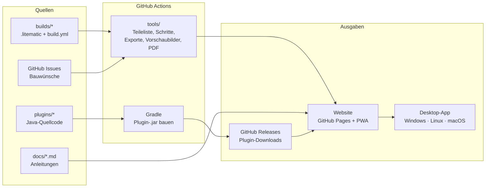

# Masterplan: minecraft-tools

Name: **Bauwerkstatt** (Zusatz: „Baupläne und Plugins für Minecraft“). „Minecraft“ darf nach den Minecraft-Nutzungsrichtlinien nicht der Hauptname sein, nur ein Zusatz. Eine Sammlung von Minecraft-Bauanleitungen und Server-Plugins für Kreative, kostenlos und einzeln herunterladbar.

Stand: 01.11.2026 · Website: <https://savox76.github.io/minecraft-tools/>

---

## 0. Aktueller Stand

| Bereich | Status | Wo |
|---|---|---|
| 12 Baupläne | ✅ **verfügbar** als Entwurf (8 davon mit Ausbau-Version und Umbau): Bauschritte, Teileliste, `.litematic`, `.schem`, CSV | [`builds/`](builds/) |
| 7 eigene Plugins | 🟡 **Doku verfügbar**, Quellcode und `.jar` integrierbar, sobald der Quellcode vorliegt | [`plugins/eigene/`](plugins/eigene/) |
| Fremde Plugins | 🟡 **vorläufige Liste** (7) aus den Server-Notizen, wird mit der vollständigen Liste ergänzt | [`plugins/fremd/plugins.json`](plugins/fremd/plugins.json) |
| 2 Anleitungen | ✅ verfügbar (Farm-Bot, CoreProtect) | [`docs/`](docs/) |
| Website | ✅ automatisch per GitHub Actions auf GitHub Pages, **Deutsch und Englisch**, Hell/Dunkel/Automatisch, suchmaschinenfreundlich (siehe 14.) | [`site/`](site/), [`tools/build_site.py`](tools/build_site.py), [`tools/seiten.py`](tools/seiten.py) |
| Geplant | 💡 153 offene Ideen für Baupläne, 14 für Anleitungen und 1 für Plugins (Nummern mit P), mit Kurztext, auf der Website unter „Geplant“; 4 schon umgesetzt | [`ideen/ideen.json`](ideen/ideen.json), Abschnitt 15 |
| Abhängigkeiten | ✅ Werkzeuge, Dienste, Spiel, Server und Plugins, teils automatisch erzeugt | Abschnitt 16 |
| Bauwünsche | ✅ Issue-Formulare, Wunschliste täglich auf der Website | [`.github/ISSUE_TEMPLATE/`](.github/ISSUE_TEMPLATE/) |

**Entwurf** heißt: Die Richtung von Treppen, Türen und Trichtern ist in den Dateien noch nicht in einer Testwelt geprüft (siehe Phase 1).

### Feste Regeln

- **Jeder neue Bauplan kommt ins Repo** als Ordner `builds/<id>/` (Format in [`builds/README.md`](builds/README.md)). Website, Bauschritte, Teileliste und Downloads entstehen daraus automatisch. Er erscheint also überall, ohne dass sonst etwas angepasst werden muss.
- **Eigene und fremde Plugins bleiben getrennt.** Eigene Plugins bekommen `plugins/eigene/<id>/plugin.json` und `README.md`, fremde einen Eintrag in `plugins/fremd/plugins.json` (nur Beschreibung, Einsatz und Link zur offiziellen Seite, keine Dateien). Die Website zeigt beides automatisch in getrennten Bereichen.
- **Änderungen gehen direkt auf `main`.**
- **Alles zweisprachig:** Neue Baupläne, Plugins und Anleitungen bekommen eine englische Fassung (`"en"` in `build.json` und `plugin.json`, `docs/en/<id>.md`, neue Blocknamen in `tools/i18n/bloecke_en.json`). Fehlt sie, zeigt die englische Seite den deutschen Text und der Build gibt einen Hinweis aus.
- **Fertig heißt: nachrücken lassen.** Ist ein Bauplan aus der Ideenliste fertig, `status` auf `verfuegbar` setzen und `python tools/ideen_masterplan.py` ausführen. Die Idee wandert unter „Umgesetzt“, und unter „Als Nächstes“ rückt per Zufall eine neue nach (Abschnitt 15).
- **Abhängigkeiten aktuell halten:** Kommt ein Werkzeug, Dienst oder Plugin dazu oder ändert sich eine Version, wird Abschnitt 16 angepasst. Welche Baupläne und Ideen welche Plugins brauchen, erzeugt `python tools/ideen_masterplan.py`.
- **Keine Links zum Quellcode auf der Website:** Die Website verlinkt nicht auf das GitHub-Repo, den Quellcode der Seite, der Plugins oder der Baupläne. Downloads (`.litematic`, `.schem`, CSV, später `.jar`) liegen direkt auf der Website. Ausnahme bisher: die Wunsch-Formulare (GitHub-Issues).
- **Kein Bezug zu LEGO:** LEGO ist die Marke eines anderen Unternehmens. Auf der Website und im Repo heißt es Bauschritte, Bauheft und Schritt-für-Schritt-Anleitung.
- **Keine erzeugten Dateien im Repo:** Website, `.litematic`, `.schem`, `.jar` und PDFs baut GitHub Actions bei jedem Push neu.

---

## 1. Ziel

- **Alle Baupläne** (Türme, Villen, Farmen, Technik) als **Schritt-für-Schritt-Anleitungen**: Zu jedem Schritt ist sofort klar, welche Blöcke in welcher Menge gebraucht werden.
- **Alle eigenen Plugins** mit Quellcode, Doku und Download.
- **Jeder Bauplan und jedes Plugin einzeln** verfügbar, ohne Gesamtpaket.
- **Gleiche Oberfläche** auf Windows, Linux und macOS.
- **Wünsche für neue Anleitungen** einreichen und abstimmen.

## 2. Empfehlung in Kürze

**Eine Codebasis, drei Ausgaben:**

| Ausgabe | Wofür | Kosten |
|---|---|---|
| **Website auf GitHub Pages** | Hauptweg. Läuft in jedem Browser auf jedem System, kein Installieren | kostenlos |
| **Offline-App (PWA)** | Dieselbe Website lässt sich mit einem Klick „installieren“ und läuft dann ohne Internet | kostenlos |
| **Desktop-App (Tauri)** | Gleiche Oberfläche plus Funktionen, die eine Website nicht kann: Baupläne direkt in den Minecraft-Ordner kopieren, Plugins mit Backup in einen Server installieren | kostenlos, Installer werden automatisch für alle 3 Systeme gebaut |

**Kann das dauerhaft auf GitHub Pages bleiben? Ja.** Das Repo ist öffentlich, und die Seite ist rein statisch, braucht also keinen eigenen Server. Die Grenzen von GitHub Pages liegen bei 1 GB Seitengröße und etwa 100 GB Datenverkehr pro Monat. Für Baupläne und Plugin-Dateien reicht das weit. Nicht erlaubt ist nur Pages als Hosting für einen Shop oder ein Geschäft. Eine kostenlose Sammlung ist in Ordnung.

**Reihenfolge:** Erst die Website mit Offline-Funktion, denn sie deckt Windows, Linux und macOS schon vollständig ab. Die Desktop-App kommt danach, sobald die lokalen Zusatzfunktionen gebraucht werden.

---

## 3. Was hinein soll (Bestand)

### Baupläne (11)

| ID | Name | Größe | Höhe | Blöcke ca. |
|---|---|---|---|---|
| `eiffelturm` | Eiffelturm (1:3), dazu Ausbau-Version (6.652 Blöcke, filigran, Abendbeleuchtung) und Umbau | 43 × 43 | 112 | 7.600 |
| `leuchtturm` | Leuchtturm, dazu Ausbau-Version (4.149 Blöcke, Küstenfels, Wärterhaus, Steg) und Umbau | Ø 17 | 65 | 2.600 |
| `villa-am-wasser` | Villa am Wasser mit Pool und Wasser-Aufzug, dazu Ausbau-Version (3.223 Blöcke, 16 Ebenen) und Umbau | 27 × 27 | 15 | 2.700 |
| `villa-modern` | Moderne Villa, dazu Ausbau-Version (2.593 Blöcke, 13 Ebenen) und Umbau | 29 × 23 | 12 | 2.000 |
| `villa-mediterran` | Mediterrane Villa, dazu Ausbau-Version (5.612 Blöcke, 18 Ebenen, Aussichtsturm) und Umbau | 27 × 27 | 16 | 3.750 |
| `villa-gruenderzeit` | Gründerzeit-Villa, dazu Ausbau-Version (3.775 Blöcke, 39 Ebenen) und Umbau | 21 × 15 + Turm | 38 | 2.750 |
| `gewaechshaus-farm` | Gewächshaus mit Dorfbewohner-Farm, dazu Ausbau-Version (1.059 Blöcke) und Umbau | 15 × 15 | 14 | 870 |
| `kellerlager` | Kellerlager mit Sortieranlage (Java) | 17 × 12 | 8 | 800 |
| `kaktus-xp-farm` | Kaktus-XP-Farm mit Ofen (Idee Nr. 1) | 9 × 10 | 6 | 320 |
| `bambusfarm-klein` | Kleine Bambusfarm mit Kolben und Beobachtern (Idee Nr. 9) | 10 × 5 | 5 | 160 |
| `teehaus-garten` | Japanisches Teehaus mit Garten, exklusive Ausführung (Idee Nr. 50, Wunsch #2) | 33 × 33 | 12 | 1.900 |
| `handelshalle-basar` | Große Handelshalle als unterirdischer Basar, quadratisch, 16 Dorfbewohner, Heilstation (Idee Nr. 117) | 21 × 21 (mit Tunnel 23 × 31) | 13 | 2.280 |

Quelle: die bisherige Bauplan-Seite (Claude-Artifact „Spawn-Baupläne“).

### Eigene Plugins (7, Paper)

| Plugin | Version | Kurz |
|---|---|---|
| AdminLogin | 1.2.0 | Admin-Passwort beim Betreten, SuperOP, Sperre nach Fehlversuchen |
| ServerShop | 1.4.0 | Coin-Shop, Spieler-Shops, Tageslimits |
| InfiniteLager | 3.2.0 | gemeinsames und privates Lager, Einlagern-Truhen, Protokoll |
| ProvokedMobs | 1.2.0 | Creeper-Schutz, umschaltbar |
| Arbeiter | 2.0.1 | Dorfbewohner-Arbeiter mit 11 Berufen, Händler |
| ServerEinstellungen | 1.2.0 | Server-Einstellungen per Chatbefehl, SuperOP-Rechte |
| ServerHilfe | 1.0.0 | Hilfe-Buch und `/hilfe`-Menü |

Quelle: der Ordner „Quellcode“ aus dem Server-Update-Paket.

### Fremde Plugins (vorläufig)

FakePlayerPlugin, ChunkLoader, EasyCommandBlocker, Simple Voice Chat, Floodgate, spark (im Einsatz) und CoreProtect (empfohlen). Die vollständige Liste folgt.

### Anleitungen ohne Bauplan

- Farm-Bot mit FakePlayerPlugin (Paper)
- Spieler-Aktionen protokollieren mit CoreProtect

---

## 4. Das Bauheft-Prinzip

So sieht eine Bauanleitung aus:

1. **Deckblatt:** Bild des fertigen Bauwerks, Name, Größe, Schwierigkeit, Bauzeit, Java/Bedrock.
2. **Gesamt-Teileliste:** alle Blöcke mit Bild und Anzahl, zusätzlich in Stacks (z. B. „12 St. + 30“). Darunter die Rohstoffe aus Farmen, zum Beispiel „1.050 Sand = Glas und Beton“.
3. **Bauschritte, nummeriert, einer pro Seite:** siehe den festen Ablauf in 4.1
4. **Unterbaugruppen** wie in einem Bauheft: Teile, die mehrfach vorkommen (Palme, Fenster-Modul, Laternenpfahl), werden einmal gezeigt und mit **„2 ד** markiert.
5. **Schritt-Regeln:** Ebene für Ebene, höchstens 60 neue Blöcke pro Schritt (Einzelheiten in 4.1). Die Schritte entstehen automatisch.
6. **Ausgaben pro Bauplan:**
   - Web-Ansicht zum Durchblättern, auf dem Handy wischbar
   - druckbares **PDF-Heft** im selben Look
   - Teileliste als **CSV**
   - Bauplan-Dateien zum direkten Einfügen ins Spiel (siehe 6.)
7. **Baufortschritt:** Erledigte Schritte lassen sich abhaken. Der Stand wird im Browser gespeichert.

### 4.1 Fester Ablauf jedes Bauplans (gilt auch für alle neuen)

Jeder Bauplan wird **Ebene für Ebene von unten nach oben** gebaut. Dieser Ablauf entsteht automatisch aus `model.json` (`tools/build_site.py`, Funktion `bau_schritte`); für einen neuen Bauplan muss dafür nichts von Hand eingestellt werden.

**So werden die Schritte gebildet**

1. **Ein Schritt gehört immer zu genau einer Ebene.** Es werden nie mehrere Ebenen in einem Schritt zusammengefasst, auch wenn eine Ebene nur wenige Blöcke hat.
2. **Höchstens 60 neue Blöcke pro Schritt.** Hat eine Ebene mehr, wird sie in gleich große Teile zerlegt: „Ebene 1 · Teil 3 von 5“. Die Teile folgen Kacheln von 8 × 8 Blöcken in Schlangenlinie, damit man im Spiel nicht kreuz und quer laufen muss.
3. **Zweite Teile gehören zum ersten:** Die obere Türhälfte und das Kopfteil vom Bett erscheinen im selben Schritt wie der untere Teil, weil Minecraft sie automatisch mitsetzt. Sie zählen nicht in der Teileliste.
4. **Gelände** (`vorhanden`) wird nie als Schritt gezeigt, sondern blass als Umgebung.
5. **Bauabschnitte** (`abschnitte` in `build.json`) teilen die Ebenen in sinnvolle Bereiche („Fundament“, „Erdgeschoss & Pool“). Jeder Schritt zeigt seinen Abschnitt mit Beschreibung.

**Das sieht man in jedem Schritt**

| Bereich | Inhalt |
|---|---|
| Schrittnummer | groß oben links, „13 von 52“ |
| 3D-Ansicht | neue Blöcke gelb umrandet, gebaute blass, spätere ausgeblendet. **Drehbar** in vier Richtungen (Südost, Nordost, Nordwest, Südwest): Knöpfe ⟲ ⟳, Ziehen mit der Maus, Wischen auf dem Handy oder Tasten Q und E. ◎ zeigt das ganze Bauwerk |
| Draufsicht der Ebene | Raster der aktuellen Ebene, Norden oben, Koordinaten ab der Mitte. Neue Blöcke gelb umrandet, schon gebaute blass, die Ebene darunter als Schatten. Antippen zeigt Block, Position und Minecraft-ID |
| Plugins | Oben auf der Bauplan-Seite: „Kein Plugin nötig“ oder jedes Plugin mit Stufe (benötigt, empfohlen, optional), Grund und Link. Karten zeigen „Plugin nötig“, Plugin-Seiten listen umgekehrt alle Baupläne und Ideen, die sie verwenden |
| Neue Teile | Kasten wie in einem Bauheft: Block-Bild, „× 12“, Name |
| Abschnitt | „Ebene 1 · Teil 3 von 5“, Name und Text des Bauabschnitts |
| Steuerung | Zurück/Weiter, Schieberegler, Pfeiltasten, „Schritt erledigt“ mit Fortschrittsbalken (im Browser gespeichert) |

Dazu gibt es pro Bauplan die Reiter **Teileliste** (gesamt, mit Stacks und Rohstoffen), **Ebenen** (jede Ebene einzeln als Draufsicht) und **Downloads** (`.litematic`, `.schem`, CSV).

**Checkliste für einen neuen Bauplan**

- [ ] `builds/<id>/model.json`: Ebene 0 ist der Boden, jede weitere Ebene liegt genau einen Block höher. Gelände mit `vorhanden` markieren, obere Türhälften und Bett-Kopfteile mit `zweiter-teil`.
- [ ] `builds/<id>/build.json`: `abschnitte` mit `von`/`bis` passend zu den Ebenen, dazu Tipps, Rohstoffe und die englische Fassung unter `en`.
- [ ] `plugins` in `build.json` eintragen: welches Plugin benötigt, empfohlen oder optional ist und warum, oder `[]`, wenn er in reinem Minecraft läuft.
- [ ] Neue Blocknamen in `tools/i18n/bloecke_en.json` eintragen.
- [ ] Lokal bauen (`python tools/build_site.py`) und in der Ausgabe Blöcke und Schritte prüfen. Danach im Browser einmal alle Schritte durchklicken und die Draufsicht ansehen.
- [ ] Auf `main` pushen. Website, Schritte, Bilder und Downloads entstehen automatisch.

### 4.2 Verfeinern wie ein Creator (Ausbau-Versionen)

Festgelegt am 11.11.2026, weil die ersten Fassungen im Spiel zu einfach und ohne Raffinesse wirken.

- **Die Grundversion bleibt immer erhalten.** Sie wird nie überschrieben. Verbesserungen kommen als zweite Fassung, die **Ausbau-Version**, mit eigenem Modell, eigener Teileliste und eigenen Downloads. Auf der Bauplan-Seite schaltet man zwischen beiden um. Dazu gibt es Ausbau-Schritte „Von der Grundversion zum Ausbau“ für alle, die schon gebaut haben.
- **Verfeinern wie ein Creator, der sein eigenes Bauwerk überarbeitet:** Grundidee, Grundriss und Funktionen bleiben, dann wird Schicht für Schicht verfeinert: Form, Fassadentiefe, Dach, Material, Details, Innenräume, Umgebung, Licht.
- **Es muss zu dem passen, was das Bauwerk werden soll.** Jeder Bauplan bekommt ein **Leitbild** (zwei, drei Sätze): was er sein soll, welche Raffinesse passt und was bewusst weggelassen wird. Beispiele: Eine moderne Villa bekommt saubere Kanten, Glas und Licht, aber kein Moos und keine Risse. Eine kleine Farm bleibt kompakt und funktional und bekommt kein Haus drumherum. Nicht jeder Bauplan braucht eine Ausbau-Version.
- **Echte Blockzustände:** Treppen, Stufen, Falltüren, Türen und Betten mit Richtung und Hälfte, damit die Details im Spiel genau so stehen wie geplant.
- **Abnahme durch Mario:** Vor dem Veröffentlichen gibt es Bilder von allen vier Seiten, von oben und als Schnitt durch die Innenräume.
- **Reihenfolge:** Pilot ist die Villa am Wasser (Leitbild: modern, hell, luxuriös am Wasser), danach die übrigen nach und nach.

**Umsetzung (Stand 11.11.2026, Pilot freigegeben und online):**

| Was | Wo |
| --- | --- |
| Ausbau-Version als eigener Ordner mit `build.json` (nur Abweichungen, Rest kommt aus der Grundversion) und `model.json` | `builds/<id>/ausbau/` |
| Erzeuger-Skript der Villa (Modell neu erzeugen) | `tools/ausbau_villa_am_wasser.py` |
| Fassungen und Umbau berechnen | `tools/varianten.py`, aufgerufen von `tools/build_site.py` |
| Daten für die Website | `data/builds/<id>--ausbau.json`, `data/builds/<id>--umbau.json` |
| Downloads | `downloads/<id>/<id>-ausbau.litematic`, `.schem`, `-ausbau-teileliste.csv`, `-umbau-liste.csv` |
| Seite | `…/bau/<id>/?fassung=ausbau` bzw. `?fassung=umbau`, Schalter oben auf der Bauplan-Seite, Vorher-Nachher-Regler |
| Echte Blockformen (Treppen, Stufen, Falltüren, Türen, Scheiben, Zäune, Laternen, Pflanzen …) | `tools/vorschau.py` (Bilder) und `site/js/render.js` (3D-Ansicht), beide lesen die Zustände aus der Minecraft-ID |

- **Umbau:** Beide Modelle liegen mit derselben Ecke Nordwest unten übereinander. Zuerst Abbau-Schritte von oben nach unten (rot umrandet), dann nur die neuen Blöcke von unten nach oben (gelb umrandet). Was gleich bleibt, ist blass und zählt nicht mit. Bei der Villa ändert sich viel: 2.183 Blöcke abbauen, 2.710 neu (Neubau: 3.223).
- **Exporte:** Glasscheiben, Eisengitter, Zäune und Mauern bekommen beim Export ihre Verbindungen zu den Nachbarn (north/east/south/west), weil Litematica und WorldEdit sie beim Einfügen nicht neu berechnen. Das gilt für alle Baupläne.
- Karten auf der Website zeigen „+ Ausbau“, wenn es eine Ausbau-Version gibt.

**Ausbau-Versionen, Stand und Reihenfolge** (Einteilung von Mario freigegeben am 11.11.2026):

| Bauplan | Ausbau | Leitbild | Stand |
| --- | --- | --- | --- |
| Villa am Wasser | ja | modern, hell, luxuriös am Wasser | online (Pilot) |
| Moderne Villa | ja | hell und reduziert, eigener Charakter: Betonsockel, viel helles Holz, Gründach, Garten mit Rasen, Birken und Pool, eingerichtet; Schwarz nur als Akzent, ohne Steg und Palmen | online, Erzeuger `tools/ausbau_villa_modern.py` |
| Mediterrane Villa | ja | warm und etwas gealtert: Putz mit Farbverläufen, Terrakotta, Pergola mit Wein, Fensterläden mit Tiefe, Zypressen, Olivenbäume; leichte Gebrauchsspuren passen. Dazu (von Mario freigegeben) Loggia mit Bögen, flaches Ziegeldach und Aussichtsturm | online, Erzeuger `tools/ausbau_villa_mediterran.py` |
| Gründerzeit-Villa | ja | reich verziert: Gesimse, Erker, Stuck aus Stufen und Treppen, Gauben mit Dachrinnen, schmiedeeiserner Zaun, Vorgarten; Tiefe durch Vor- und Rücksprünge. Umgesetzt mit Zwerchhaus (Norden), Erker (Osten), Schieferdach, Balkon über der Veranda | online, Erzeuger `tools/ausbau_villa_gruenderzeit.py` |
| Leuchtturm | klein | rauer Küstenfels statt glattem Sockel, Wärterhaus, Steg mit Booten, Felsen im Wasser; Turm nur feinere Streifen und Geländer | online, Erzeuger `tools/ausbau_leuchtturm.py` (liest den Turm aus der Grundversion) |
| Gewächshaus-Farm | klein | Farm bleibt, dazu Rahmen aus dunklem Holz, Pflanzkästen, Wege, Laternen | online, Erzeuger `tools/ausbau_gewaechshaus.py` (liest die Grundversion). Fehler der Grundversion behoben: Pfosten vor der Nische ist jetzt Glas |
| Kellerlager | klein | Gewölbe, Holzbalken, beschriftete Fass-Wand, Licht; Technik bleibt | als Nächstes |
| Eiffelturm | ja (von Mario vorgezogen) | filigraner: Fachwerk mit offenen Feldern, Bögen zwischen den Beinen, Abendbeleuchtung (Froschlichter, Lichterketten, Bodenstrahler), Platz mit Brunnen | online, Erzeuger `tools/ausbau_eiffelturm.py` (liest die Grundversion) |
| Kaktus-XP-Farm, Kleine Bambusfarm | nein | bleiben kompakt und funktional | – |
| Teehaus | nein | schon im neuen Stil gebaut | – |

Echte Fehler in Grundversionen (falsch gedrehte Treppe, Tür ohne Richtung) werden korrigiert, das Design der Grundversion bleibt.

**Wichtige Änderung gegenüber heute:** Die bisherigen Modelle kennen keine **Blockrichtungen** (wohin eine Treppe zeigt, obere oder untere Stufe). Für echte Genauigkeit wird jeder Bau einmal in einer Kreativ-Testwelt nachgebaut oder geprüft und als `.litematic` exportiert. Diese Datei ist ab dann die Quelle für alles andere. Dabei wird jeder Bauplan automatisch einmal real getestet.

---

## 5. Architektur



**Technik-Entscheidungen**

| Teil | Wahl | Warum |
|---|---|---|
| Website | HTML, CSS und JavaScript-Module ohne Build-Schritt | läuft sofort auf GitHub Pages, kein Node nötig, eine Oberfläche für Web und Desktop. Ein Umstieg auf Vite und Svelte bleibt möglich, falls die Seite stark wächst |
| 3D-Ansicht | eigene isometrische Canvas-Darstellung | leicht, zoomt pro Schritt auf das Gebaute, hebt neue Blöcke hervor. Three.js kommt erst dazu, wenn freies Drehen und Zoomen gebraucht wird |
| Bauplan-Pipeline | Python (`litemapy`, `nbtlib`, `Markdown`) | liest und schreibt `.litematic`, `.schem`, später auch `.nbt` und Bedrock-`.mcstructure` |
| PDF-Heft | Playwright druckt die Schritt-Seiten | PDF sieht genau aus wie die Website |
| Desktop | Tauri 2 | kleine Installer (etwa 10 MB statt 100 MB bei Electron), gleiche Oberfläche |
| Plugins | Gradle-Multiprojekt, Paper-API, Java 21 | ein Befehl baut alle 7, jedes einzeln versioniert |
| Wünsche | GitHub-Issue-Formulare | kein eigener Server nötig, Abstimmung per 👍 |
| Sprachen | Deutsch und Englisch | `"en"` in den JSON-Dateien, `docs/en/`, `tools/i18n/` |

---

### 5.1 Gestaltung

- **Leitidee:** Ein Bauplan ist eine Blaupause. Überall, wo gebaut wird (Startseite, Schritt-Ansicht), steht das Modell auf einer bauplanblauen Fläche mit Raster. Der Fußbereich nimmt das Blau wieder auf. Alles andere bleibt ruhig.
- **Farben:** Bauplatte-Grau als Seite, Weiß für Inhalte, Bauplan-Blau für Bühnen, hellblaue Teile-Kästen wie in einem Bauheft, Signalgelb nur für „neu“. Hell, Dunkel und Automatisch über Farbvariablen in `site/style.css`.
- **Schrift:** Archivo breit für Überschriften, Schrittnummern und Stückzahlen, Atkinson Hyperlegible für Text, JetBrains Mono nur für Minecraft-IDs, Befehle und Koordinaten.
- **Kopfbereich:** Banner mit einer Minecraft-Landschaft aus Blöcken (Meer, Strand mit Leuchtturm, Wiese mit Haus und Feld, Wald, Berge mit Schnee). Tagsüber hell, im Dunkelmodus Nacht mit Sternen, Mond und leuchtendem Leuchtturm. Das Bild zeichnet `tools/seiten.py` (Funktion `landschaft`) bei jedem Bauen selbst, mit eigenen Farben statt Minecraft-Texturen. Darunter eine dunkle Menüleiste, die beim Scrollen stehen bleibt.
- **Startseite:** eine lebende Seite aus dem Bauheft: Schrittnummer, Teile-Kasten mit den Blöcken des Schritts und das wachsende Modell.
- **Regeln:** keine Großbuchstaben-Etiketten über Überschriften, keine Hüpf-Effekte auf Karten, Bewegung nur in der Startseiten-Animation (und nicht bei „weniger Bewegung“).

## 6. Downloads pro Eintrag

**Pro Bauplan**

| Datei | Für wen |
|---|---|
| `.litematic` | Java mit Litematica-Mod: Bauplan als Geisterblöcke im Spiel |
| `.schem` | WorldEdit oder FastAsyncWorldEdit auf Servern |
| `.nbt` | Strukturblock in Vanilla Java (bis 48 × 48 × 48, größere werden geteilt) |
| `.mcstructure` | Bedrock (Strukturblock) |
| `anleitung.pdf` | Ausdrucken, Tablet |
| `teileliste.csv` | Excel und Co. |

**Pro Plugin**
- `.jar` aus GitHub Releases. Jedes Plugin hat eigene Tags, z. B. `arbeiter-v2.0.1`.
- `README` mit Befehlen, Rechten und `config.yml` erklärt.
- Changelog.
- Getestete Paper-Version.

Jede Detailseite hat einen eigenen, teilbaren Link, etwa `…/#/bau/leuchtturm` oder `…/#/plugin/arbeiter`.

---

## 7. Repo-Struktur

```
minecraft-tools/
├─ MASTERPLAN.md
├─ README.md                  Einstieg, Disclaimer, Links
├─ LICENSE-CODE               Lizenz für Code und Plugins
├─ LICENSE-CONTENT            Lizenz für Baupläne und Texte
├─ builds/
│  └─ leuchtturm/
│     ├─ build.yml            Name, Beschreibung, Tags, Schritte-Overrides, Tipps
│     ├─ leuchtturm.litematic Quelle der Wahrheit
│     └─ README.md            optional: Hintergrund, Varianten
├─ plugins/
│  ├─ eigene/
│  │  ├─ arbeiter/            plugin.json, README.md, später src/ und build.gradle.kts
│  │  └─ …
│  └─ fremd/plugins.json      Plugins anderer Entwickler: Zweck, Einsatz, Link
├─ docs/                      Anleitungen (Farm-Bot, CoreProtect)
├─ tools/                     build_site.py (Schritte, Teileliste, Exporte, Website-Daten), seiten.py (vorgerenderte Seiten,
│                             Vorschaubilder, Sitemap), fetch_wishes.py, site_config.json
├─ site/                      Website: index.html, style.css, js/app.js, js/render.js
├─ desktop/                   später: Tauri-Hülle um site/
└─ .github/
   ├─ workflows/              website.yml (heute), später plugins.yml, desktop.yml
   └─ ISSUE_TEMPLATE/         bauwunsch.yml, plugin-wunsch.yml, fehler.yml
```

### Format eines Bauplans

Heute besteht jeder Bauplan aus `build.json` (Beschreibung, Abschnitte, Tipps, Rohstoffe) und `model.json` (Blöcke mit Minecraft-ID, Ebene für Ebene). Alle Felder stehen in [`builds/README.md`](builds/README.md).

Ab Phase 1 kommt eine `.litematic`-Datei aus der Testwelt als Quelle dazu. `model.json` wird dann daraus erzeugt, inklusive Blockrichtungen.

---

## 8. Phasenplan

Aufwand in **Arbeitssitzungen** (eine Sitzung = ein Abend gemeinsam mit Claude).

### Phase 0 · Fundament (1 Sitzung)
- [ ] Lizenzen festlegen und Dateien anlegen (siehe 10.)
- [x] README mit Disclaimer: „Kein offizielles Minecraft-Produkt …“
- [x] Repo-Ordner wie in 7. anlegen
- [x] Issue-Formulare: Bauwunsch, Plugin-Wunsch, Fehler melden
- [x] Workflow für GitHub Pages (Quelle: GitHub Actions)

**Fertig, wenn:** Eine leere Seite unter `savox76.github.io/minecraft-tools` erreichbar ist und ein Bauwunsch als Issue eingereicht werden kann.

### Phase 1 · Bauplan-Pipeline (2–3 Sitzungen)
- [ ] `.litematic` einlesen, inklusive Blockrichtungen
- [x] Teileliste und Rohstoffe (aus den bisherigen Modellen übernommen)
- [x] Automatische Schritt-Aufteilung nach den Schritt-Regeln aus 4.
- [x] Exporte: `.litematic`, `.schem`, `teileliste.csv`
- [ ] Exporte: `.nbt`, `.mcstructure`
- [x] Vorschaubilder (werden im Browser gezeichnet)
- [x] Check: Jeder Bauplan muss im Workflow fehlerfrei durchlaufen, auch bei Pull Requests
- [x] **Migration:** die 8 bisherigen Modelle sind als Entwurf im Repo
- [ ] In der Kreativ-Testwelt richten (Treppen, Türen) und als `.litematic` zurück ins Repo, Status dann `geprueft`

**Fertig, wenn:** Der Leuchtturm vollständig mit allen Exporten durchläuft und im Spiel per Litematica korrekt erscheint.

### Phase 2 · Website (3–4 Sitzungen)
- [x] Katalog: Kacheln mit Vorschaubild, Filter nach Kategorie
- [ ] Filter nach Größe, Schwierigkeit, Edition
- [x] Bauplan-Seite: Kenndaten, Teileliste, Schritt-Ansicht wie in einem Bauheft, 3D drehbar, Ebenen-Ansicht, Download-Knöpfe
- [x] Baufortschritt abhaken, gespeichert im Browser
- [ ] Koordinaten-Helfer (wie bisher): Mitte eintragen, echte X/Y/Z pro Block
- [x] Plugin-Seiten: Beschreibung, Befehle, Rechte, Config, Änderungen
- [ ] Download der neuesten Version (nach Phase 4)
- [x] Anleitungs-Seiten aus `docs/`
- [x] Wunschliste: offene Bauwünsche, sortiert nach 👍
- [ ] PWA: installierbar und offline nutzbar (Manifest steht, Offline-Speicher fehlt noch)
- [x] Hell, Dunkel oder Automatisch (wie das Gerät), Handy-tauglich, Wischen zwischen Schritten
- [x] Deutsch und Englisch: eigene Adressen unter `/en/`, Sprachschalter im Kopf, alle Baupläne, Plugins, Anleitungen und Blocknamen übersetzt
- [x] Vorschaubilder der Karten werden im Browser gezeichnet (wie die 3D-Ansicht); das vorgerenderte Bild beim ersten Laden bleibt im Bildfeld

**Fertig, wenn:** Alle Baupläne, Plugins und Anleitungen online sind und jede Seite einen eigenen Link hat. Stand: erledigt bis auf die offenen Punkte oben.

### Phase 3 · PDF-Bauhefte (1 Sitzung)
- [ ] Druck-Layout für Deckblatt, Teileliste, Schritte (2 pro Seite bei kleinen Schritten)
- [ ] Automatisch bei jeder Änderung neu erzeugen und zum Download anbieten

### Phase 4 · Plugins ins Repo (2–3 Sitzungen)
- [ ] Quellcode der 7 Plugins übernehmen, Gradle-Multiprojekt
- [ ] **Sicherheits-Check vor dem Hochladen:** keine Passwörter, Server-IPs, playit-Adressen oder persönlichen Spielernamen im Code oder in Standard-Configs
- [ ] Texte auslagern, damit sie übersetzbar sind (Deutsch und Englisch)
- [x] Pro Plugin: README (Befehle, Rechte, Config, Änderungen)
- [x] Workflow: Ein Tag `<plugin>-v<version>` baut die `.jar` und hängt sie an ein Release (`.github/workflows/plugins.yml`, mit Testserver-Start)
- [ ] Optional: zusätzlich auf Modrinth und Hangar veröffentlichen

**Fertig, wenn:** Jedes Plugin einzeln über die Website als `.jar` herunterladbar ist.

### Phase 5 · Desktop-App (2 Sitzungen)
- [ ] Tauri-Hülle um dieselbe Website
- [ ] Lokale Zusatzfunktionen:
  - „In Minecraft öffnen“: kopiert `.litematic` in `.minecraft/schematics`
  - „In Server installieren“: Server-Ordner wählen, Plugin kopieren, vorher Backup (wie heute `INSTALLIEREN.bat`)
  - Offline-Gesamtpaket aller Baupläne
- [ ] Workflow: Installer für Windows (`.msi`), macOS (`.dmg`) und Linux (`.AppImage`, `.deb`) bei jedem Release
- [ ] Hinweis für Nutzer: Ohne kostenpflichtige Code-Signatur zeigen Windows („Der Computer wurde geschützt“) und macOS beim ersten Start eine Warnung

### Phase 6 · Community (1 Sitzung, danach laufend)
- [ ] `CONTRIBUTING.md`: So reicht man einen eigenen Bauplan ein (`.litematic` + `build.yml` per Pull Request)
- [ ] Automatische Prüfung eingereichter Baupläne
- [ ] Wunsch-Ablauf: Issue → Label `angenommen` → in Arbeit → fertig, dann automatisch mit dem neuen Bauplan verlinkt

---

## 9. Bauwünsche

1. Auf der Website auf **„Bauplan wünschen“** klicken. Das öffnet ein GitHub-Formular mit den Feldern Name des Bauwerks, Stil, ungefähre Größe, Java/Bedrock, Referenzbilder und gewünschte Rohstoffe.
2. Andere stimmen mit **👍** ab.
3. Einmal pro Tag holt ein Workflow die offenen Wünsche und schreibt sie als Datei in die Website. Besucher brauchen dafür kein GitHub-Konto und die Seite keine Live-Abfrage.
4. Zum Einreichen braucht man ein kostenloses GitHub-Konto. Ein Formular ohne Konto ginge nur mit einem Zusatzdienst, das ist eine spätere Option.

---

## 10. Rechtliches und Sicherheit

- **Kein Minecraft-Material verbreiten:** keine Original-Texturen, Sounds oder das Logo im Repo. Die Blöcke werden wie bisher mit eigenen Farben dargestellt. In der Desktop-App kann jeder optional sein **eigenes** Ressourcenpaket laden, das dann nur lokal genutzt wird.
- **Disclaimer** auf jeder Seite: „Kein offizielles Minecraft-Produkt. Nicht von Mojang oder Microsoft genehmigt oder mit ihnen verbunden.“ Das Tool darf nicht offiziell wirken.
- **Kostenlos:** Die Minecraft-EULA verbietet, mit Mods oder Inhalten Geld zu verdienen. Alles bleibt also gratis.
- **Lizenz-Vorschlag:**
  - Code und Plugins: **MIT** (jeder darf nutzen und ändern, Namensnennung bleibt)
  - Baupläne und Texte: **CC BY 4.0** (frei nutzbar mit Namensnennung) oder **CC BY-NC 4.0** (zusätzlich keine kommerzielle Nutzung durch andere)
- **Plugins:** Vor jeder Veröffentlichung auf Passwörter und Adressen prüfen (siehe Phase 4). AdminLogin speichert Passwörter verschlüsselt, das bleibt so.
- **Datenschutz:** Die Website setzt keine Cookies und kein Tracking. Der Baufortschritt bleibt nur im Browser des Nutzers.
- **Impressum:** Ob eine private, kostenlose Seite ein Impressum braucht, hängt davon ab, ob sie als geschäftsmäßig gilt, etwa durch eine Verbindung zur Marke Savox. Das vor dem Start kurz prüfen. Ich bin kein Anwalt.

---

## 11. Ideen für später

- **Ingame-Plugin „BauHelfer“:** zeigt den aktuellen Bauschritt als Geisterblöcke direkt auf dem Server, prüft, ob alles richtig gesetzt ist, und hakt den Schritt ab. Funktioniert ohne Mod, also auch für Bedrock-Spieler.
- **Shop-Preisrechner:** Was kostet ein Bauplan in Coins im eigenen ServerShop?
- **Farm-Planer:** Welche Farmen braucht ein Bauplan, und wie lange dauert das Sammeln?
- **Lageplan-Editor:** mehrere Baupläne plus Farm-Bot-Radius auf einer Karte anordnen
- **Zeitraffer-Animation:** jeder Bauplan als kurzes Video oder GIF, Schritt für Schritt
- **Varianten:** Größen (1:1, 1:2) und Materialvarianten (Holz- oder Steinversion) per Klick
- **Bauplan-Pakete:** zusammengehörige Pläne gebündelt, z. B. „Villa am Wasser + Kellerlager + Gewächshaus“
- **Server-Setup-Assistent:** Paper, Plugins, Bot und Einstellungen in einem geführten Ablauf (Desktop-App)

---

## 12. Offene Entscheidungen

| # | Frage | Mein Vorschlag |
|---|---|---|
| 1 | Name des Projekts | ✅ „Bauwerkstatt“ mit Zusatz „Baupläne und Plugins für Minecraft“ (vorher „Savox Bauwerkstatt“) |
| 2 | Lizenz Baupläne | CC BY-NC 4.0 |
| 3 | Lizenz Code und Plugins | MIT |
| 4 | Sprachen | ✅ Deutsch und Englisch, seit Phase 2 umgesetzt |
| 5 | Plugin-Quellcode öffentlich? | Ja, nach dem Sicherheits-Check |
| 6 | Bedrock-Export (`.mcstructure`) | Ja, weil dein Server Bedrock-Spieler hat |
| 7 | Desktop-App sofort oder später? | Später (Phase 5), die Website deckt erst einmal alles ab |
| 8 | Eigene Domain statt `savox76.github.io/minecraft-tools`? | Optional, auch später möglich (ca. 10 €/Jahr) |

---

## 13. Nächster Schritt

Entscheidungen aus Abschnitt 12 treffen (vor allem die Lizenz), dann den Plugin-Quellcode übernehmen (Phase 4). Parallel kannst du schon einmal den Leuchtturm in einer Kreativ-Testwelt bauen und als `.litematic` exportieren. Er wird der erste vollständige Bauplan in der Pipeline.

---

## 14. Gefunden werden (Suchmaschinen)

### Was die Website automatisch macht

- **Echte Adressen** pro Seite, z. B. `…/bau/leuchtturm/` statt `…/#/bau/leuchtturm`. Alte `#/`-Links werden umgeleitet.
- **Zwei Sprachen:** jede Seite gibt es auf Deutsch und auf Englisch (`…/en/build/leuchtturm/`). `hreflang`-Verweise sagen Google, welche Seite zu welcher Sprache gehört, so erscheint im Ausland die englische Fassung. Keine automatische Umleitung, der Besucher wählt selbst.
- **Vorgerenderte Seiten:** Jede Seite enthält ihren kompletten Text (Beschreibung, Bauabschnitte, Teileliste, Rohstoffe, Downloads, Befehle) schon im HTML. Suchmaschinen lesen ihn ohne JavaScript, im Browser übernimmt dann die interaktive Ansicht.
- **Pro Seite:** eigener Titel mit Suchbegriffen („Leuchtturm in Minecraft bauen – Bauplan in 58 Schritten“), Beschreibung, Canonical-Link, Open-Graph- und Twitter-Vorschau.
- **Vorschaubilder:** pro Bauplan ein Bild (800 × 600) und ein Link-Vorschaubild (1200 × 630) für WhatsApp, Discord und soziale Netzwerke.
- **Strukturierte Daten (JSON-LD):** `HowTo` für Baupläne (Material und Bauabschnitte), `SoftwareApplication` für Plugins, `TechArticle` für Anleitungen, `BreadcrumbList` überall.
- **`sitemap.xml`** mit allen Seiten und Bildern, `404.html`, interne Links im Fußbereich zu allen Seiten.
- **IndexNow:** Nach jedem Push meldet der Workflow alle Adressen an Bing, Yandex, Seznam und weitere Suchmaschinen.

### Was nur du machen kannst (einmalig)

- [x] **Google Search Console:** <https://search.google.com/search-console> → Property hinzufügen → **URL-Präfix** `https://savox76.github.io/minecraft-tools/` → Bestätigung per **HTML-Tag**. Den Code aus `content="…"` in [`tools/site_config.json`](tools/site_config.json) bei `google_site_verification` eintragen (oder mir schicken), pushen, ein paar Minuten warten, dann „Bestätigen“ klicken. ✅ Code ist in `tools/site_config.json` eingetragen (01.11.2026); in der Search Console auf „Bestätigen“ klicken.
- [ ] Danach in der Search Console unter **Sitemaps** `sitemap.xml` einreichen.
- [ ] **Bing Webmaster Tools:** <https://www.bing.com/webmasters> → „Aus Google Search Console importieren“. Bing beliefert auch DuckDuckGo und Ecosia.
- [ ] **GitHub-Repo:** Auf der Repo-Seite rechts bei „About“ das Zahnrad → Website `https://savox76.github.io/minecraft-tools/` eintragen, Topics: `minecraft`, `minecraft-schematics`, `litematica`, `worldedit`, `paper-plugin`, `minecraft-plugin`.

### Bekannt machen (Links von außen)

Suchmaschinen bewerten eine Seite auch danach, wer auf sie verlinkt.

- **Planet Minecraft** (planetminecraft.com): die größte Seite für Baupläne. Jeden Bauplan mit Bild und `.litematic` hochladen und auf die Schritt-für-Schritt-Anleitung verlinken.
- **Modrinth und Hangar:** sobald die Plugins als `.jar` fertig sind (Phase 4), dort veröffentlichen und die Website als Homepage angeben.
- **Reddit:** r/Minecraft, r/MinecraftBuilds, r/admincraft (für die Plugins), deutschsprachig r/minecraftDE. Am besten mit einem Bild oder GIF der Schritt-Animation.
- **Savox-Kanäle:** Zeitraffer eines Baus als Short oder TikTok mit Link zum Bauplan.
- **Discord:** Minecraft-Bau- und Server-Admin-Communities.

### Wichtig zu wissen

- Eine neue Seite braucht meist einige Tage bis wenige Wochen, bis sie bei Google erscheint. Die Search Console zeigt, welche Seiten schon aufgenommen sind.
- `robots.txt` wird von Suchmaschinen nur direkt auf `savox76.github.io/` gelesen, nicht im Unterordner. Deshalb ist das Einreichen der Sitemap in der Search Console der wichtige Weg.
- Mit einer eigenen Domain (Masterplan 12., Punkt 8) wäre die Seite unabhängig von GitHub und leichter zu merken. Dann nur `site_url` in `tools/site_config.json` ändern.

---

## 15. Ideen-Speicher: geplante Baupläne und Anleitungen

Alle Ideen stehen in [`ideen/ideen.json`](ideen/ideen.json), jeweils mit Nummer, Kategorie, Größe, Status und kurzem Text auf Deutsch und Englisch. Daraus entstehen automatisch die Seite **Geplant** auf der Website (`/geplant/`, englisch `/en/planned/`) und die Tabellen unten.

**Ablauf**
- Neue Idee: Eintrag in `ideen/ideen.json` mit der nächsten freien Nummer, danach `python tools/ideen_masterplan.py` ausführen. Das schreibt die Tabellen unten neu.
- **Wünsche aus GitHub-Issues** (Bau- oder Plugin-Wunsch) werden als Idee aufgenommen. Das Feld `"wunsch": <Issue-Nummer>` verknüpft die Idee mit dem Issue: Auf der Geplant-Seite führt „Mitstimmen“ dann direkt dorthin, und die 👍 werden gezählt.
- **Plugin-Ideen** stehen in der Kategorie `plugins` mit Nummern P1, P2 … (Anleitungen: A1, A2 …). Sie rücken nicht unter „Als Nächstes“ nach, weil dort nur Bauplan-Ideen stehen.
- Wird eine Idee umgesetzt: `status` auf `in-arbeit`, dann auf `verfuegbar` mit `"bauplan": "<id>"`. **Fertige Ideen verschwinden dann automatisch von der Geplant-Seite** und stehen hier unten unter „Umgesetzt“ zur Erinnerung. In `ideen/ideen.json` bleiben sie erhalten (Nummern werden nie neu vergeben).
- **„Als Nächstes“ rückt per Zufall nach:** Auf der Geplant-Seite stehen immer **3** offene Bauplan-Ideen unter „Als Nächstes“ (`"empfohlen": true`). Ist eine davon fertig, zieht `python tools/ideen_masterplan.py` per Zufall eine andere offene Bauplan-Idee nach (keine Anleitungen und keine Plugin-Ideen) und speichert sie in `ideen/ideen.json`. So bleibt die Auswahl fest, bis wieder etwas fertig ist. Vergisst man den Aufruf, ergänzt der Website-Build vorläufig selbst und meldet einen Hinweis. Die Regel steht in `tools/empfehlung.py`.
- Der Text über „Als Nächstes“ steht in `ideen/ideen.json` unter `empfohlen_text`, mit `fuer` = die Nummern, zu denen er passt. Rückt eine Idee nach, für die er nicht passt, erscheint automatisch ein allgemeiner Text.
- Plugins: Braucht eine Idee ein Plugin, steht es unter `plugins` mit `id` und `stufe` (`benoetigt`, `empfohlen`, `optional`). Die Geplant-Seite zeigt es auf der Karte.
- Abstimmen: Auf der Geplant-Seite führt „Wünschen“ zu einem vorausgefüllten Bauwunsch („Idee #61: Kakaofarm“). Gibt es dazu schon einen offenen Wunsch, zeigt die Seite dessen 👍-Stimmen und verlinkt dorthin.
- Größe: klein (bis etwa 15 × 15), mittel, groß. Für Nachbauten echter Wahrzeichen gibt der Bauplan einen Maßstab an (wie beim Eiffelturm 1:3).

**Hinweis zu Paper:** Farmen, die Sand, TNT oder Teppiche vervielfältigen, laufen auf Paper normalerweise nicht und stehen deshalb nicht auf der Liste. Bäume fällt am besten der Holzfäller aus dem Arbeiter-Plugin. Monsterfarmen laufen nur, wenn ein Spieler oder der Farm-Bot in der Nähe ist.

<!-- ideen:start -->
168 offene Ideen (167 💡 Idee, 1 🔨 in Arbeit), 4 schon umgesetzt (siehe „Umgesetzt“ am Ende).

**Als Nächstes empfohlen:** Nr. 11 Bambus-Brennstoffstation, Nr. 114 Holstentor Lübeck, Nr. 47 Blockhütte am See.

### Skillfarmen (XP) (8)

Erfahrung für Verzauberungen und Reparaturen.

| Nr. | Vorschlag | Größe | Beschreibung | Status |
|---|---|---|---|---|
| 2 | Seetang-XP-Ofen | klein | Wie die Kaktus-Farm, nur mit Seetang. Gibt weniger Erfahrung, liefert dafür getrockneten Seetang, der als Block ein guter Brennstoff ist. | 💡 Idee |
| 3 | Dunkelraum-Monsterfarm | mittel | Ein dunkler Turm, in dem Monster spawnen und in eine Kammer fallen, wo ein Schlag reicht. Nebenbei Knochen, Pfeile, Schießpulver und Fäden. Plugin: fakeplayerplugin (empfohlen). | 💡 Idee |
| 4 | Spawner-XP-Farm | klein | Rund um einen gefundenen Zombie- oder Skelett-Spawner. Sehr ergiebig und schnell gebaut, aber nur dort möglich, wo ein Spawner liegt. Plugin: fakeplayerplugin (empfohlen). | 💡 Idee |
| 5 | Lohenfarm | mittel | An einem Lohen-Spawner in der Netherfestung. Viel XP und Lohenruten für Braustände und Enderaugen. Plugin: fakeplayerplugin (empfohlen). | 💡 Idee |
| 6 | Goldfarm auf dem Nether-Dach | groß | Zombifizierte Piglins werden mit Schildkröteneiern angelockt und fallen in eine Kammer. Sehr viel XP und Gold. | 💡 Idee |
| 7 | Endermanfarm im End | groß | Die schnellste XP-Quelle im Spiel, dazu Enderperlen. Der Enderdrache muss vorher besiegt sein. | 💡 Idee |
| 8 | Kleine Handelshalle | klein | Sechs Dorfbewohner in einer Reihe, jeder in einer eigenen Zelle hinter seinem Arbeitsblock. Gehandelt wird über den Block hinweg, so kann niemand weglaufen. Mit zwei Bibliothekaren für Verzauberungsbücher, etwa 15 × 9 Blöcke. Plugin: arbeiter (optional). | 💡 Idee |
| 118 | Große Handelshalle im Stil einer Zauberschule | groß | Eine hohe Halle mit Spitzbogen-Gewölbe, schwebenden Kerzen aus Lichtblöcken und langen Tafeln in der Mitte. Die Händler stehen in Nischen an den Seitenwänden, über ihnen Galerien mit Bücherregalen und Bannern. Plugin: arbeiter (optional). | 💡 Idee |

### Farmen für Baumaterial (21)

Liefern die Blöcke und Rohstoffe für die Baupläne.

| Nr. | Vorschlag | Größe | Beschreibung | Status |
|---|---|---|---|---|
| 10 | Große Bambusfarm | groß | Zwei Reihen mit je 16 Pflanzen. Eine Trichterlore unter Glas sammelt in eine Fasskette. Genug für Bambusbretter und Mosaik in großen Mengen. Plugin: fakeplayerplugin (empfohlen). | 💡 Idee |
| 12 | Melonen- und Kürbisfarm | klein | Beobachter und Kolben ernten, sobald eine Frucht wächst. Kürbisse für Laternen und Golems, Melonen als Essen. Plugin: fakeplayerplugin (empfohlen). | 💡 Idee |
| 13 | Wollfarm | klein | Schafe fressen Gras, ein Werfer mit Schere schert sie automatisch. Eine Farbe pro Kammer für bunte Bauten. | 💡 Idee |
| 14 | Honig- und Waben-Farm | klein | Bienenstöcke mit Werfern für Flaschen und Scheren. Honigblöcke, Waben für Kerzen und gewachste Kupferblöcke. | 💡 Idee |
| 15 | Eisenfarm | mittel | Dorfbewohner werden von einem Zombie erschreckt, dabei entstehen Eisengolems. Eisen für Trichter, Schienen und Laternen. Plugin: fakeplayerplugin (empfohlen). | 💡 Idee |
| 16 | Schneefarm mit Schneegolems | klein | Schneegolems hinterlassen Schnee, der automatisch abgebaut wird. Schneeblöcke und Eis zum Bauen. | 💡 Idee |
| 17 | Lava aus Tropfstein | klein | Spitzer Tropfstein unter einer Lavaquelle füllt einen Kessel. Unendlich Lava als Brennstoff, ohne in den Nether zu müssen. | 💡 Idee |
| 18 | Basalt-Generator | klein | Lava, Blaueis und Seelenerde erzeugen immer neuen Basalt. Daraus wird polierter Basalt und glatter Basalt. | 💡 Idee |
| 19 | Bruchstein-Generator | klein | Lava und Wasser erzeugen Bruchstein nach, du baust nur noch ab. Grundlage für Steinziegel, glatten Stein und Treppen. | 💡 Idee |
| 20 | Moosfarm | klein | Werfer mit Knochenmehl lassen Moos wachsen. Moos, Azaleen und Material für den Komposter. | 💡 Idee |
| 21 | Kuh- und Hühnerfarm | klein | Kleine Gehege mit Begrenzung, damit die Tiere nicht überhandnehmen. Leder für Bücher, Federn, Eier und Fleisch. | 💡 Idee |
| 60 | Zuckerrohrfarm | klein | Eine Reihe Zuckerrohr mit Beobachtern und Kolben. Papier für Bücher, Karten und Raketen. Plugin: fakeplayerplugin (empfohlen). | 💡 Idee |
| 61 | Kakaofarm | klein | Beobachter und Kolben ernten Kakaobohnen am Tropenbaumstamm. Für Kekse und braunen Farbstoff. Plugin: fakeplayerplugin (empfohlen). | 💡 Idee |
| 62 | Blumenfarm | klein | Ein Werfer mit Knochenmehl auf Gras lässt Blumen wachsen. Alle Grundfarben für Wolle, Beton und Glas. | 💡 Idee |
| 64 | Tonfarm | mittel | Werfer mit Wasserflaschen machen Erde zu Schlamm, Tropfstein darunter macht daraus Ton. Für Terrakotta und Ziegel. | 💡 Idee |
| 65 | Froschlicht-Farm | groß | Frösche fressen kleine Magmawürfel und lassen dabei Froschlichter fallen. Leuchtblöcke in drei Farben. | 💡 Idee |
| 66 | Amethyst-Farm | mittel | An einer gefundenen Geode: Beobachter merken reife Kristalle, Kolben brechen sie ab. Für Fernrohr und getöntes Glas. | 💡 Idee |
| 67 | Chorusfrucht-Farm im End | mittel | Halbautomatisch: Chorusblumen wachsen nach, du erntest. Chorusfrüchte werden zu Purpurblöcken. | 💡 Idee |
| 68 | Pilzfarm | klein | Ein dunkler Raum, in dem sich Pilze von selbst ausbreiten. Für Suppen und Riesenpilz-Deko. | 💡 Idee |
| 150 | Große Kaktusfarm | groß | Mehrere Etagen mit Kaktus auf Sand. Wächst ein Kaktus an einen Zaun heran, bricht er ab und fällt in Wasserrinnen, die alles zu Trichtern und Fässern führen. Zusammen mit einer großen Ofenbatterie eine starke XP-Quelle und viel grüner Farbstoff. Plugin: fakeplayerplugin (empfohlen). | 💡 Idee |
| 156 | Dorfbewohner-Zucht | mittel | Dorfbewohner vermehren sich mit Betten und Essen von einem Bauern. Die Kinder werden per Wasserkanal zur Handelshalle gebracht. | 💡 Idee |

### Monsterfarmen (3)

Material für Redstone und Raketen.

| Nr. | Vorschlag | Größe | Beschreibung | Status |
|---|---|---|---|---|
| 22 | Schleimfarm | mittel | In einem Schleim-Chunk oder Sumpf. Schleimbälle für Klebekolben und Schleimblöcke. Plugin: fakeplayerplugin (empfohlen). | 💡 Idee |
| 23 | Hexenfarm | groß | An einer Sumpfhütte. Redstone, Leuchtsteinstaub, Zucker und Flaschen. Plugin: fakeplayerplugin (empfohlen). | 💡 Idee |
| 24 | Creeperfarm | mittel | Nur Creeper spawnen auf Spezialblöcken. Schießpulver für Raketen. Plugin: fakeplayerplugin (empfohlen). | 💡 Idee |

### Verarbeitung und Fabriken (9)

Machen aus Rohstoffen fertige Dinge, ganz von selbst.

| Nr. | Vorschlag | Größe | Beschreibung | Status |
|---|---|---|---|---|
| 11 | Bambus-Brennstoffstation | klein | Koppelt die Bambusfarm an die Ofenbatterie. Die Öfen laufen dann ohne Kohle. | 💡 Idee |
| 63 | Komposter-Kette | klein | Überschuss aus Bambus, Kaktus und Seetang wird in Kompostern zu Knochenmehl. | 💡 Idee |
| 69 | Holzkohle-Station | klein | Stämme vom Holzfäller-Arbeiter werden in Öfen zu Holzkohle. Plugin: arbeiter (benötigt). | 💡 Idee |
| 70 | Erz-Schmelzstation | mittel | Eine Einwurftruhe verteilt auf viele Öfen gleichzeitig, die Ausgabe landet sortiert in Fässern. | 💡 Idee |
| 71 | Automatische Werkbank (Crafter) | mittel | Der Crafter aus 1.21 stellt Dinge selbst her, zum Beispiel Brot, Papier oder Eisenblöcke. | 💡 Idee |
| 72 | Raketen-Fabrik | mittel | Papier und Schießpulver werden per Crafter zu Raketen für Elytra-Flüge. | 💡 Idee |
| 73 | Automatische Brauerei | mittel | Braustände mit Trichtern für Zutaten und Lohenpulver. Tränke in Serie. | 💡 Idee |
| 74 | Automatische Küche | klein | Räucheröfen mit Trichtern, gefüttert aus der Kuh- und Hühnerfarm. | 💡 Idee |
| 75 | Buch-Station | mittel | Zuckerrohr und Leder werden zu Büchern und Bücherregalen. | 💡 Idee |

### Funktionale Bauten (16)

Technik und Komfort für Basis und Server.

| Nr. | Vorschlag | Größe | Beschreibung | Status |
|---|---|---|---|---|
| 25 | Verzauberungsraum | klein | Zaubertisch mit 15 Bücherregalen, dazu Amboss und Schleifstein. Passt direkt zu den XP-Farmen. | 💡 Idee |
| 26 | Marktplatz für Spieler-Shops | mittel | Stände für die Shop-Truhen aus dem ServerShop-Plugin, mit Schildern und Laternen. Plugin: servershop (benötigt). | 💡 Idee |
| 27 | Lorenbahnhof | mittel | Gleise vom Spawn zu allen Farmen, mit Haltestellen und Fahrplan-Schildern. | 💡 Idee |
| 76 | Blasen-Aufzug | klein | Seelensand fährt hoch, Magmablock runter. Als eigener Bauplan zum Einbauen in jedes Haus. | 💡 Idee |
| 77 | Item-Aufzug | klein | Eine Blasensäule hebt Gegenstände vom Keller nach oben ins Lager. | 💡 Idee |
| 83 | Leuchtfeuer-Pyramide | mittel | Eisenblöcke aus der Eisenfarm, Effekte wie Eile beim Abbauen. | 💡 Idee |
| 84 | Aquisitor-Rahmen | klein | Gibt Atmung unter Wasser, zum Beispiel rund um die Glaskuppel. | 💡 Idee |
| 85 | Nether-Knotenpunkt | groß | Portale zu allen Basen und eine Eisstraße für schnelle Bootsfahrten. | 💡 Idee |
| 86 | Kartenraum | mittel | Karten in Rahmen ergeben eine große Wandkarte der Welt. | 💡 Idee |
| 87 | Farm-Bot-Zentrale | klein | Ein sicherer, beleuchteter Raum für den Farm-Bot, mitten zwischen den Farmen. Plugin: fakeplayerplugin (benötigt). | 💡 Idee |
| 88 | Lagerhalle mit Einlagern-Truhen | mittel | Für das InfiniteLager-Plugin, gemeinsamer und privater Bereich getrennt. Plugin: infinitelager (benötigt). | 💡 Idee |
| 89 | Werkstatt | klein | Amboss, Schleifstein, Schmiedetisch, Webstuhl und Steinsäge an einem Ort. | 💡 Idee |
| 90 | Ausrüstungsraum | klein | Rüstungsständer, Waffen und Werkzeuge geordnet an der Wand. | 💡 Idee |
| 91 | Beleuchteter Spawn | mittel | Ein Laternen-Raster, damit am Spawn keine Monster entstehen, und das sieht trotzdem gut aus. | 💡 Idee |
| 103 | Sortiermodul | klein | Eine einzelne Sortierstrecke zum Anbauen an jede Farm, ohne ganzes Kellerlager. | 💡 Idee |
| 104 | Müllschlucker | klein | Eine Truhe, deren Inhalt in Kaktus oder Lava verschwindet. Für Überschuss, den niemand braucht. | 💡 Idee |

### Redstone-Projekte (11)

Geheimtüren, Anzeigen, Steuerungen und Spielereien mit Redstone.

| Nr. | Vorschlag | Größe | Beschreibung | Status |
|---|---|---|---|---|
| 78 | Versteckte Kolbentür 2 × 2 | klein | Öffnet per Knopf oder Druckplatte und verschwindet in der Wand. | 💡 Idee |
| 79 | Geheimgang hinter Bücherregal | klein | Der klassische Geheimeingang, zum Beispiel zum Lager. | 💡 Idee |
| 80 | Tresor mit Zahlenschloss | mittel | Ein Redstone-Kombinationsschloss mit Hebeln. Nur wer den Code kennt, kommt rein. | 💡 Idee |
| 81 | Automatisches Licht | klein | Ein Tageslichtsensor schaltet Redstone-Lampen ab Abend ein. | 💡 Idee |
| 82 | Zugbrücke | mittel | Kolben fahren die Brücke ein und aus. Passt zur Burg. | 💡 Idee |
| 151 | Versenkbare Treppe | klein | Auf Knopfdruck fährt eine Treppe aus dem Boden und führt in einen geheimen Keller. Danach verschwindet sie wieder. | 💡 Idee |
| 152 | Lager-Füllstandsanzeige | klein | Komparatoren lesen Truhen und Fässer aus, eine Reihe Redstone-Lampen zeigt, wie voll das Lager ist. | 💡 Idee |
| 153 | Schaltzentrale | mittel | Ein Raum mit Hebeln und Kontrolllampen schaltet Licht, Türen und Farmen der ganzen Basis. | 💡 Idee |
| 154 | Notenblock-Glockenspiel | klein | Verstärker geben den Takt vor, Notenblöcke spielen eine Melodie. Startet per Knopf, die Lieder lassen sich umstecken. | 💡 Idee |
| 155 | Disco-Tanzfläche | mittel | Redstone-Lampen im Boden blinken in wechselnden Mustern, ein Taktgeber steuert sie. Für Events auf dem Server. | 💡 Idee |
| 157 | Versteckte Kolbentür 3 × 3 | mittel | Bündig in der Wand, öffnet sich von innen und außen. Größer und aufwendiger als die 2 × 2 Tür. | 💡 Idee |

### Tiere (5)

Gehege, Ställe und Aquarien.

| Nr. | Vorschlag | Größe | Beschreibung | Status |
|---|---|---|---|---|
| 92 | Schildkröten-Brutstation | klein | Ein Strand mit Schildkröten, deren Eier geschützt schlüpfen. Für Schildkrötenpanzer und Tränke. | 💡 Idee |
| 93 | Axolotl-Aquarium | klein | Ein großes Glasbecken als Deko im Haus. Axolotl helfen später auch beim Kampf unter Wasser. | 💡 Idee |
| 94 | Pferdestall mit Koppel | mittel | Boxen, Heulager und eine Koppel zum Züchten schneller Pferde. | 💡 Idee |
| 95 | Tierheim für zahme Tiere | klein | Ein sicheres Haus für Hunde, Katzen und Papageien, geschützt vor Monstern. | 💡 Idee |
| 97 | Schnüffler-Gehege | mittel | Schnüffler graben seltene Samen aus: Fackellilien und Kannenpflanzen für besondere Gärten. | 💡 Idee |

### Spiel und Freizeit (5)

Für Events und gemeinsame Abende auf dem Server.

| Nr. | Vorschlag | Größe | Beschreibung | Status |
|---|---|---|---|---|
| 98 | Arena mit Tribüne | mittel | Für Mob-Kämpfe oder Duelle, mit Zuschauerrängen und Eingangstoren. | 💡 Idee |
| 99 | Parkour-Strecke | mittel | Sprünge in Stufen von leicht bis schwer, mit Kontrollpunkten. | 💡 Idee |
| 100 | Heckenlabyrinth | mittel | Ein Irrgarten aus Laub mit Schatz in der Mitte. | 💡 Idee |
| 101 | Elytra-Startturm | mittel | Ein hoher Turm mit Startplattform und gepolstertem Landeplatz. | 💡 Idee |
| 102 | Bogenschießstand | klein | Zielblöcke geben ein Redstone-Signal, ein Lämpchen zeigt Treffer an. | 💡 Idee |

### Mystery-Bauwerke (14)

Bauwerke mit Geheimnissen: versteckte Gänge, Rätsel, Ruinen und verlassene Orte.

| Nr. | Vorschlag | Größe | Beschreibung | Status |
|---|---|---|---|---|
| 136 | Spukvilla mit Geheimgängen | groß | Eine verfallene Villa mit knarrenden Dielen, verdeckten Kolbentüren hinter Bildern und Regalen und einem Gang, der in eine verborgene Gruft führt. | 💡 Idee |
| 137 | Escape-Room-Haus | mittel | Ein Haus voller Redstone-Rätsel: Hinweise auf Schildern und in Büchern, Hebel in der richtigen Reihenfolge öffnen den nächsten Raum. Ideal für Server-Events. | 💡 Idee |
| 138 | Rätselgrab in der Wüste | groß | Ein Grabmal mit Fallen, Druckplatten-Rätseln und einer Schatzkammer, die sich nur mit dem richtigen Code öffnet. | 💡 Idee |
| 139 | Versunkene Tempelstadt | groß | Ruinen einer Stadt am Meeresgrund, halb im Sand begraben, mit Säulen, eingestürzten Dächern und einem Tempel voller Prismarin. | 💡 Idee |
| 140 | Steinkreis mit Geheimkammer | mittel | Uralte Steine im Kreis. Wer die Hebel an den Steinen richtig umlegt, öffnet eine Treppe in eine Kammer darunter. | 💡 Idee |
| 141 | Verlassenes Bergwerk | mittel | Ein Stollen mit Holzstützen, rostigen Schienen, umgekippten Loren und einem eingestürzten Gang, hinter dem etwas Seltsames leuchtet. | 💡 Idee |
| 142 | Geisterschiff | mittel | Ein Wrack mit zerrissenen Segeln, schief im Nebel liegend, mit Laternen, die nachts von allein zu leuchten scheinen. | 💡 Idee |
| 143 | Bibliothek hinter dem Wasserfall | mittel | Ein Wasserfall verdeckt den Eingang zu einer Höhle mit Bücherregalen, Lesepult und einer Karte zum nächsten Geheimnis. | 💡 Idee |
| 144 | Hexenturm im Sumpf | mittel | Ein schiefer Turm auf Stelzen mit Kesseln, Braustand, Kräutergarten und einer Falltür ins Ungewisse. | 💡 Idee |
| 145 | Geisterdorf | groß | Ein verlassenes Dorf mit leeren Häusern, Spinnweben, überwucherten Wegen und einem Brunnen, der tiefer führt, als er sollte. | 💡 Idee |
| 146 | Uhrturm mit Geheimkammer | mittel | Hinter dem Ziffernblatt liegt eine Kammer mit Zahnrädern aus Blöcken. Ein versteckter Mechanismus öffnet den Weg nach oben. | 💡 Idee |
| 147 | Schwarzer Monolith | klein | Ein glatter Block aus Obsidian mitten im Nirgendwo, mit Inschriften auf Schildern und einer Kammer, die nur nachts erreichbar ist. | 💡 Idee |
| 148 | Friedhof mit Gruft | mittel | Grabsteine, alte Bäume, eine Kapelle und darunter eine Gruft mit Kerzen und einem versiegelten Raum. | 💡 Idee |
| 149 | Sternwarte der Sterndeuter | mittel | Ein Turm mit Kuppel, Sternbildern aus Lichtblöcken im Boden und einem Rätsel, das nur mit Blick in den Nachthimmel lösbar ist. | 💡 Idee |

### Monumente (29)

Nachbauten bekannter Wahrzeichen, mit passendem Maßstab.

| Nr. | Vorschlag | Größe | Beschreibung | Status |
|---|---|---|---|---|
| 30 | Brandenburger Tor | mittel | Das Berliner Wahrzeichen mit Säulen und der Quadriga aus Kupfer. | 💡 Idee |
| 31 | Big Ben | groß | Der Uhrturm in London mit vier Zifferblättern, gut im Maßstab 1:2. | 💡 Idee |
| 32 | Kölner Dom | groß | Zwei Türme, Spitzbögen und bunte Glasfenster. | 💡 Idee |
| 33 | Frauenkirche Dresden | groß | Die steinerne Glockenkuppel aus hellem Sandstein. | 💡 Idee |
| 34 | Freiheitsstatue | groß | Gebaut aus Kupfer, das im Spiel mit der Zeit von selbst grün wird. | 💡 Idee |
| 35 | Schiefer Turm von Pisa | mittel | Die Schräge entsteht durch versetzte Ringe, dazu Säulengänge. | 💡 Idee |
| 36 | Kolosseum | groß | Ovale Arena mit Bögen, teilweise eingestürzt wie im Original. | 💡 Idee |
| 37 | Schloss Neuschwanstein | groß | Türme und Spitzdächer auf einem Felsen. | 💡 Idee |
| 38 | Tower Bridge | groß | Zwei Türme mit Klappbrücke, die mit Kolben funktionieren kann. | 💡 Idee |
| 39 | Pyramide mit Grabkammer | groß | Braucht viel Sandstein. Sand lässt sich auf Paper nicht farmen, also vorher sammeln. | 💡 Idee |
| 40 | Japanische Pagode | mittel | Fünf Stockwerke mit geschwungenen Dächern. | 💡 Idee |
| 41 | Maya-Tempel | mittel | Stufenpyramide mit großer Treppe und Dschungel-Deko. | 💡 Idee |
| 42 | Stonehenge | klein | Ein Steinkreis, gut als erstes Monument. | 💡 Idee |
| 111 | Parthenon | groß | Der griechische Tempel auf der Akropolis, mit umlaufenden Säulen. | 💡 Idee |
| 112 | Chinesische Mauer | mittel | Ein Abschnitt mit Wachtürmen, der sich über Hügel zieht. | 💡 Idee |
| 113 | Taj Mahal | groß | Weißer Palast mit großer Kuppel, vier Minaretten und Wasserbecken. | 💡 Idee |
| 114 | Holstentor Lübeck | mittel | Das Backsteintor mit zwei runden Türmen und Spitzhelmen. | 💡 Idee |
| 115 | Rialtobrücke | mittel | Steinbrücke mit Läden über einem Kanal, wie in Venedig. | 💡 Idee |
| 116 | Moai-Köpfe | klein | Die steinernen Köpfe der Osterinsel, schnell gebaut und gut als Deko am Strand. | 💡 Idee |
| 119 | Notre-Dame de Paris | groß | Die gotische Kathedrale mit zwei Fassadentürmen, großer Fensterrose und Strebebögen an den Seiten. | 💡 Idee |
| 120 | Hagia Sophia | groß | Riesige flache Kuppel über einem quadratischen Bau, ringsum Halbkuppeln und vier schlanke Minarette. | 💡 Idee |
| 121 | Petersdom mit Petersplatz | groß | Die große Kuppel über der Basilika, davor der ovale Platz mit Säulengängen und einem Obelisken in der Mitte. | 💡 Idee |
| 122 | Angkor Wat | groß | Tempelanlage mit fünf Türmen in Form von Lotusknospen, umgeben von einem breiten Wassergraben. | 💡 Idee |
| 123 | Mont-Saint-Michel | groß | Eine Klosterinsel im Meer: Häuser und Mauern ziehen sich spiralförmig den Felsen hoch, oben die Abtei mit Spitze. | 💡 Idee |
| 124 | Machu Picchu | groß | Steinterrassen und Ruinen auf einem Bergsattel, passt perfekt in Minecraft-Berge. | 💡 Idee |
| 125 | Golden Gate Bridge | groß | Hängebrücke mit zwei roten Pylonen und Tragseilen aus Ketten, über eine Meeresbucht gespannt. | 💡 Idee |
| 126 | Alhambra | groß | Palastanlage mit Innenhöfen, Wasserbecken, Bogengängen und fein gemusterten Wänden. | 💡 Idee |
| 127 | Koloss von Rhodos | groß | Das antike Weltwunder als riesige Bronzestatue an einer Hafeneinfahrt, die Schiffe fahren darunter durch. | 💡 Idee |
| 128 | Empire State Building | groß | Der Art-déco-Wolkenkratzer mit gestuften Absätzen und Spitze, gut im Maßstab 1:3. | 💡 Idee |

### Gebäude (32)

Eigene Entwürfe vom Wachturm bis zum Luftschiff.

| Nr. | Vorschlag | Größe | Beschreibung | Status |
|---|---|---|---|---|
| 28 | Windmühle | klein | Deko-Hülle für eine Bambus- oder Melonenfarm. Sieht aus wie ein Bauwerk, darin steckt eine Farm. | 💡 Idee |
| 29 | Hafen mit Steg und Bootshaus | mittel | Passt zur Villa am Wasser und zum Leuchtturm. | 💡 Idee |
| 43 | Mittelalterliche Burg | groß | Ringmauer, Torhaus, Bergfried und Burghof. | 💡 Idee |
| 44 | Wachturm | klein | Steinturm mit Holzdach und Leiter, gut für Grenzen und Wege. | 💡 Idee |
| 45 | Fachwerkdorf | mittel | Bäckerei, Schmiede und Gasthaus im Fachwerkstil. | 💡 Idee |
| 46 | Bauernhof mit Scheune und Silo | mittel | Farmen aus der Liste lassen sich darin unauffällig verstecken. | 💡 Idee |
| 47 | Blockhütte am See | klein | Rundholz, Kamin und ein kleiner Steg. | 💡 Idee |
| 48 | Baumhaus im Riesen-Dschungelbaum | mittel | Mehrere Plattformen, verbunden mit Hängebrücken. | 💡 Idee |
| 49 | Unterwasser-Glaskuppel | mittel | Eine Wohnkuppel am Meeresgrund mit Blick auf die Fische. | 💡 Idee |
| 51 | Zwergenhalle im Berg | groß | Eine große Halle mit Säulen, in den Berg gebaut statt in die Tiefe. | 💡 Idee |
| 52 | Hochhaus | groß | Moderne Glasfassade, jede Etage als eigener Bauabschnitt. | 💡 Idee |
| 53 | Rathaus mit Uhrturm am Spawn | mittel | Treffpunkt für alle, mit Hilfe-Schildern und Infotafeln. Plugin: serverhilfe (empfohlen). | 💡 Idee |
| 54 | Hängebrücke | mittel | Über eine Schlucht oder einen Fluss, mit Seilen aus Ketten oder Zäunen. | 💡 Idee |
| 55 | Gartenpavillon mit Brunnen | klein | Ein schneller Einstieg, passt zu den Villen. | 💡 Idee |
| 56 | Große Bibliothek | mittel | Bücherregale über zwei Etagen, Lesesaal und Galerie. | 💡 Idee |
| 57 | Dorfkapelle | klein | Kleiner Bau mit Glockenturm und Buntglas. | 💡 Idee |
| 58 | Luftschiff | mittel | Hülle aus Wolle, Gondel aus Holz, schwebt über dem Spawn. | 💡 Idee |
| 59 | Piratenschiff | mittel | Masten, Segel aus Wolle und ein Kanonendeck. | 💡 Idee |
| 96 | Fischerhütte mit Angelsteg | klein | Kleine Hütte am Wasser, Fässer für den Fang und ein Steg zum Angeln. | 💡 Idee |
| 105 | Weihnachtsmarkt | mittel | Buden, Tannenbäume mit Lichtern und ein Glühwein-Stand. Passt zur Adventszeit auf dem Server. | 💡 Idee |
| 106 | Winterdorf mit Iglus | klein | Iglus aus Schnee, Eisbahn und Lagerfeuer für ein Winter-Event. | 💡 Idee |
| 107 | U-Bahn-Station | mittel | Unterirdischer Bahnsteig für das Lorennetz, mit Treppen und Lichtern. | 💡 Idee |
| 108 | Wasserrad | klein | Ein Mühlrad am Bach als Deko, passt zu Fachwerkdorf und Bauernhof. | 💡 Idee |
| 109 | Marktbrunnen | klein | Ein verzierter Brunnen als Mittelpunkt für Marktplatz oder Spawn. | 💡 Idee |
| 110 | Sternwarte | mittel | Kuppel mit Fernrohr-Raum und Sternenkarte an der Wand. | 💡 Idee |
| 129 | Schwebende Insel mit Wasserfällen | groß | Eine Insel hoch über dem Spawn mit Wurzeln an der Unterseite, Wasserfällen über den Rand und einem kleinen Tempel obendrauf. | 💡 Idee |
| 130 | Vulkanfestung | groß | Eine dunkle Festung aus Schwarzstein und Basalt in einem Vulkankrater, mit Lavafällen und einer Brücke über den Lavasee. | 💡 Idee |
| 131 | Elfenstadt in Riesenbäumen | groß | Häuser auf mehreren Ebenen in riesigen eigenen Bäumen, verbunden durch Brücken, Wendeltreppen und Laternen. | 💡 Idee |
| 132 | Bergkloster an der Felswand | groß | Ein Kloster, das an einer steilen Felswand klebt, mit Treppen im Fels und Glockenturm über dem Abgrund. | 💡 Idee |
| 133 | Unterwasserstadt | groß | Mehrere Glaskuppeln am Meeresgrund, verbunden durch Tunnel, mit Gärten aus Korallen und Seetang. | 💡 Idee |
| 134 | Riesenrad | mittel | Ein großes Rad aus Ketten und Zäunen mit bunten Gondeln, als Blickfang für Marktplatz oder Hafen. | 💡 Idee |
| 135 | Staudamm | groß | Eine gewaltige Staumauer zwischen zwei Bergen, vorne Wasserfälle aus den Auslässen, oben eine Straße. | 💡 Idee |

### Anleitungen (14)

Wissen rund um Server, Farmen und Bauen.

| Nr. | Anleitung | Inhalt | Status |
|---|---|---|---|
| A1 | Redstone-Grundlagen | Beobachter, Komparator, Verstärker und Trichter-Richtungen einfach erklärt, mit Bildern. | 💡 Idee |
| A2 | Litematica einrichten | Mod installieren, Bauplan laden und die Geisterblöcke richtig ausrichten. | 💡 Idee |
| A3 | WorldEdit-Dateien einfügen | Eine .schem-Datei auf den Server laden und an der richtigen Stelle einsetzen. | 💡 Idee |
| A4 | Paper-Server einrichten | Von der Installation über die Einstellungen bis zu den ersten Plugins. | 💡 Idee |
| A5 | Bedrock-Spieler verbinden | Geyser und Floodgate einrichten, Whitelist ohne Passwort. Plugin: floodgate (benötigt). | 💡 Idee |
| A6 | Automatische Backups | Die Welt regelmäßig sichern und im Notfall zurückspielen. | 💡 Idee |
| A7 | Lag finden mit spark | Messung starten, Bericht lesen, typische Ursachen beheben. Plugin: spark (benötigt). | 💡 Idee |
| A8 | Rohstoff-Übersicht | Welche Farm liefert welches Baumaterial, und was sich nicht farmen lässt. | 💡 Idee |
| A9 | Server von außen erreichbar machen | Tunnel statt Portfreigabe, und worauf man dabei achten muss. | 💡 Idee |
| A10 | Spielerleitfaden | Regeln, wichtige Befehle und das Hilfe-Buch für neue Spieler. | 💡 Idee |
| A11 | Farmen klein halten | Überlauf-Stopp mit Komparator: Die Farm hält an, wenn das Fass halb voll ist. Plugin: fakeplayerplugin (optional). | 💡 Idee |
| A12 | Dorfbewohner-Handel verbessern | Arbeitsblöcke, Heilen von Zombie-Dorfbewohnern und bessere Preise. | 💡 Idee |
| A13 | Wahrzeichen in Blöcke umrechnen | Wie man aus echten Maßen einen Maßstab wählt, damit der Nachbau machbar bleibt. | 💡 Idee |
| A14 | Elytra finden und nutzen | Endstadt finden, Elytra reparieren, Raketen und sichere Landeplätze. | 💡 Idee |

### Plugin-Ideen (1)

Eigene Plugins, die noch entstehen sollen, oft direkt von Spielern gewünscht.

| Nr. | Plugin-Idee | Beschreibung | Wunsch | Status |
|---|---|---|---|---|
| P1 | BossRaid: Boss-Kämpfe mit Arena und Raids | Starke Bosse mit eigenen Fähigkeiten, Phasen und Boss-Leiste, die richtig Schaden machen und guten Loot fallen lassen. Spieler beschwören sie selbst an einem Altar, die Regeln jedes Raids stellst du per Befehl ein. Ausgearbeitetes Konzept: Abschnitt 17. | [Issue #3](https://github.com/Savox76/minecraft-tools/issues/3) | 🔨 in Arbeit |

### ✅ Umgesetzt (4)

Diese Ideen sind fertige Baupläne. Sie stehen nicht mehr auf der Geplant-Seite, sondern bei den Bauplänen.

| Nr. | Idee | Bauplan |
|---|---|---|
| 1 | Kaktus-XP-Farm mit Ofenbatterie | [`builds/kaktus-xp-farm`](builds/kaktus-xp-farm/) |
| 117 | Große Handelshalle (Unterirdischer Basar) | [`builds/handelshalle-basar`](builds/handelshalle-basar/) |
| 50 | Japanisches Teehaus mit Garten | [`builds/teehaus-garten`](builds/teehaus-garten/) |
| 9 | Kleine Bambusfarm | [`builds/bambusfarm-klein`](builds/bambusfarm-klein/) |
<!-- ideen:ende -->

---

## 16. Abhängigkeiten

Alles, wovon das Projekt abhängt. Bei Updates (neue Minecraft-Version, neue Plugin-Version, neue Python-Version) diese Liste durchgehen. Die Tabelle 16.6 wird automatisch aus den Daten erzeugt (`python tools/ideen_masterplan.py`), alles andere wird von Hand gepflegt.

### 16.1 Website bauen (Python)

| Was | Version | Wofür | Wo festgelegt |
|---|---|---|---|
| Python | 3.12 | Erzeugt Website, Bauschritte, Bilder und Downloads | `.github/workflows/website.yml` |
| litemapy | 0.11.0b0 (fest) | Schreibt `.litematic`-Dateien | `tools/requirements.txt` |
| nbtlib | ≥ 2.0, < 3 | Schreibt `.schem`-Dateien (NBT) | `tools/requirements.txt` |
| Markdown | ≥ 3.5, < 4 | Anleitungen aus `docs/` in HTML umwandeln | `tools/requirements.txt` |
| Pillow | ≥ 10 | Vorschaubilder und Link-Vorschaubilder | `tools/requirements.txt` |
| DejaVu-Schriften | `fonts-dejavu-core` | Schrift in den Link-Vorschaubildern | Workflow installiert sie bei Bedarf |

Im Browser läuft die Website ohne fremde Bibliotheken: eigenes JavaScript (ES-Module) und Canvas für die 3D-Ansicht.

### 16.2 GitHub und Dienste

| Was | Wofür | Hinweis |
|---|---|---|
| GitHub-Repo `Savox76/minecraft-tools` | Quelle für alles | Änderungen direkt auf `main` |
| GitHub Actions: `actions/checkout@v4`, `actions/setup-python@v5`, `actions/upload-pages-artifact@v3`, `actions/deploy-pages@v4` | Website bei jedem Push und täglich neu bauen und veröffentlichen | `deploy-pages@v4` läuft bereits mit Hinweis auf Node 24; bei Gelegenheit auf neuere Versionen heben |
| GitHub Pages | Hosting unter `savox76.github.io/minecraft-tools/` | Muss in den Repo-Einstellungen auf „GitHub Actions“ stehen |
| GitHub Issues und Labels (`bauwunsch`, `plugin-wunsch`, `fehler`, `angenommen`) | Wünsche und Abstimmung mit 👍 | Workflow legt die Labels an, `tools/fetch_wishes.py` liest die Wünsche täglich |
| Google Fonts: Archivo, Atkinson Hyperlegible, JetBrains Mono | Schriften der Website | Werden vom Browser geladen; ohne Verbindung greift eine Systemschrift |
| IndexNow (`api.indexnow.org`) | Meldet neue Seiten an Bing und weitere Suchmaschinen | Schlüssel in `tools/site_config.json` |
| Google Search Console, Bing Webmaster Tools | Sichtbarkeit bei Google und Bing | Google-Code eingetragen (`tools/site_config.json`); Bing per Import aus der Search Console (siehe 14.) |

### 16.3 Lokal ansehen und testen

| Was | Wofür |
|---|---|
| `python -m http.server` | Website lokal ansehen (siehe README) |
| Playwright mit Chromium | Nur für Bildschirm-Tests beim Entwickeln, nicht im Repo und nicht im Workflow |

### 16.4 Spiel und Server

| Was | Version | Wofür |
|---|---|---|
| Minecraft Java | 1.21 oder neuer | Baupläne sind für Java geplant; Downloads werden mit Daten-Version 3953 (1.21) geschrieben und von neueren Versionen umgewandelt. Ideen mit dem Crafter brauchen mindestens 1.21 |
| Minecraft Bedrock | über Geyser und Floodgate | Bedrock-Spieler auf dem Java-Server; Baupläne mit Bedrock-Markierung lassen sich dort nachbauen |
| Paper | passend zur Minecraft-Version | Server-Software für alle Plugins |
| Java | 21 oder neuer | Paper und FakePlayerPlugin (AFKDummyForFarming bräuchte Java 25) |
| Litematica (Mod, Java) | aktuelle Version zur Minecraft-Version | Öffnet die `.litematic`-Downloads als Geisterblöcke |
| WorldEdit oder FastAsyncWorldEdit | aktuelle Version | Fügt die `.schem`-Downloads auf dem Server ein |

### 16.5 Plugins untereinander

Laut Dokumentation der eigenen Plugins. Ob es harte Abhängigkeiten sind (Plugin startet sonst nicht) oder weiche (Funktion fällt nur weg), wird geprüft, sobald der Quellcode im Repo ist (Phase 4).

| Plugin | Braucht oder nutzt | Wofür |
|---|---|---|
| Alle eigenen Plugins | Paper | Laufen nur auf Paper |
| Arbeiter | ServerShop | Arbeiter werden mit Coins gekauft; Händler öffnen den Shop einer Kategorie |
| Arbeiter | InfiniteLager | Arbeiter können in das private Lager ihres Besitzers liefern |
| Arbeiter | FakePlayerPlugin oder ChunkLoader (empfohlen) | Arbeiter arbeiten nur in geladenen Chunks |
| ServerHilfe | alle eigenen Plugins (nur Texte) | Das Hilfe-Buch erklärt Shop, Lager, Arbeiter und Farm-Bot; bei neuen Befehlen die Texte anpassen |
| Floodgate | Geyser | Floodgate lässt Bedrock-Spieler ohne Java-Konto herein; die Verbindung selbst stellt Geyser her. Geyser fehlt noch in der Liste der fremden Plugins |
| BossRaid (geplant, P1) | ServerShop (optional) | Beschwörungsgegenstände zusätzlich im Shop verkaufen |
| EasyCommandBlocker | Befehle aller Plugins | Die Liste der für Spieler sichtbaren Befehle muss bei neuen Befehlen ergänzt werden |

### 16.6 Baupläne und Ideen brauchen Plugins

Wird aus `plugins` in `builds/*/build.json` und `ideen/ideen.json` erzeugt.

<!-- abhaengigkeiten:start -->
| Plugin | Benötigt von | Empfohlen für | Optional bei |
|---|---|---|---|
| Arbeiter (eigenes) | Idee Nr. 69 Holzkohle-Station | – | Idee Nr. 8 Kleine Handelshalle, Idee Nr. 118 Große Handelshalle im Stil einer Zauberschule |
| FakePlayerPlugin (fremdes) | Idee Nr. 87 Farm-Bot-Zentrale | Bauplan Kleine Bambusfarm, Bauplan Gewächshaus-Farm, Bauplan Kaktus-XP-Farm, Idee Nr. 3 Dunkelraum-Monsterfarm, Idee Nr. 4 Spawner-XP-Farm, Idee Nr. 5 Lohenfarm, Idee Nr. 10 Große Bambusfarm, Idee Nr. 150 Große Kaktusfarm, Idee Nr. 12 Melonen- und Kürbisfarm, Idee Nr. 15 Eisenfarm, Idee Nr. 60 Zuckerrohrfarm, Idee Nr. 61 Kakaofarm, Idee Nr. 22 Schleimfarm, Idee Nr. 23 Hexenfarm, Idee Nr. 24 Creeperfarm | Idee Nr. A11 Farmen klein halten |
| Floodgate (fremdes) | Idee Nr. A5 Bedrock-Spieler verbinden | – | – |
| InfiniteLager (eigenes) | Idee Nr. 88 Lagerhalle mit Einlagern-Truhen | – | Bauplan Kellerlager |
| ServerHilfe (eigenes) | – | Idee Nr. 53 Rathaus mit Uhrturm am Spawn | – |
| ServerShop (eigenes) | Idee Nr. 26 Marktplatz für Spieler-Shops | – | Idee Nr. P1 BossRaid: Boss-Kämpfe mit Arena und Raids |
| spark (fremdes) | Idee Nr. A7 Lag finden mit spark | – | – |

Ohne Plugin (reines Minecraft): Eiffelturm, Handelshalle: Unterirdischer Basar, Leuchtturm, Japanisches Teehaus mit Garten, Villa am Wasser, Gründerzeit-Villa, Mediterrane Villa, Moderne Villa.
<!-- abhaengigkeiten:ende -->

---

## 17. Plugin-Konzepte

Ausgearbeitete Konzepte für geplante eigene Plugins. Die Kurzfassung steht in `ideen/ideen.json` (Feld `konzept`) und erscheint auf der Website unter „Plugins → In Planung“ und auf der Geplant-Seite.

### 17.1 P1 BossRaid: Boss-Kämpfe mit Arena und Raids

**Herkunft:** Plugin-Wunsch [Issue #3](https://github.com/Savox76/minecraft-tools/issues/3). Name „BossRaid“ ist ein Arbeitstitel. Status: 🔨 in Arbeit. Konzept abgestimmt am 04.11.2026, **Version 0.1.0 gebaut am 06.11.2026** (Quellcode und Anleitung: `plugins/eigene/bossraid/`).

**Umsetzung 0.1.0 (06.11.2026)**
- Fertig: Arenen mit festem Radius, Boss-Spawn, Eingang, Altar mit vier Kerzen, Tor per Torstab; Raid-Vorlagen mit allen Feldern; Beschwörung am Altar mit Ritual, verfluchte Version, Abklingzeit, Rückfrage bei Einzelspielern; Admin-Start mit `/raid beitreten`; drei Phasen, Boss-Leiste mit Restzeit; Fähigkeiten-Baukasten in `bosse.yml` (salve, beschwoeren, teleport, zone, schockwelle, wurf, verstaerker, fluch, flucht, heilkreis, steinhaut); Zeitlimit und Scheitern ohne lebende Spieler; Todesregeln normal, grabtruhe, behalten; Leben pro Spieler; persönlicher Loot nach Schadensanteil; Schutz gegen Tricks; Aufräumen nach Neustart; Bosse **Nekromant, Sumpfhexe, Steingolem** mit Fragmenten, Rezepten, epischen Gegenständen und Trophäen.
- Ergänzt gegenüber dem Konzept: **Fragment-Tageslimit** (8 pro Spieler und Tag) und keine Fragmente von Spawner-Monstern (außer Höhlenspinnen), damit Monsterfarmen die Beschwörung nicht entwerten. Todesregel gilt nur in der Arena während eines Raids, sonst bleibt „Inventar behalten“ des Servers. Ausgeschiedene stehen normal wieder auf und kommen nicht mehr in die Arena (Zuschauermodus ist auf dem Server gesperrt). Farm-Bots per `ignorierte-spieler` ausgeschlossen. Das Hilfe-Buch wird nie abgenommen. Boss-Leben über der Minecraft-Grenze rechnet das Plugin intern um.
- Build: `.github/workflows/plugins.yml` baut bei jeder Änderung, startet einen Paper-Testserver mit dem Plugin und prüft das Log. Ein Tag `bossraid-v<version>` hängt die `.jar` an ein Release.
- Offen: Test im Spiel (Checkliste in der README), Paper-Version des Servers prüfen, die übrigen fünf Bosse (brauchen neue Bausteine: Fliegen, Eisgefängnis, Netze, Kanonade, Platztausch, Kristallsäulen), Boss-Pfad, feste Termine, Kopf-Texturen für Trophäen, Bestenliste.

**Ziel:** Bosse, die richtig Schaden machen und an denen man auch sterben kann, dafür mit gutem Loot. **Hauptweg ist die Beschwörung durch Spieler** an einem Altar; die Regeln jedes Raids stellt der Admin per Befehl ein. Admin-Start und feste Termine bleiben für Events.

**Bosse: alle acht vollständig geplant**

Jeder Boss baut auf einem normalen Monster auf (kein Mod nötig). Die Bosse sind in vier Stufen eingeteilt; der Loot früherer Bosse hilft gegen die späteren.

| Stufe | Bosse | Umsetzung |
|---|---|---|
| I | Nekromant, Sumpfhexe | zuerst |
| II | Steingolem, Spinnenkönigin, Frostkönigin | danach |
| III | Piratenkapitän, Feuerdämon | danach |
| IV (Finale) | Endwächter | zum Schluss |

Für alle gilt:
- **Leben** in der Tabelle für leicht · normal · schwer und einen Spieler. Ab dem zweiten Spieler +40 % Leben pro weiterem Teilnehmer.
- **Schaden** auf leicht ×0,7, auf schwer ×1,3. Spezialangriffe der Phasen werden immer angekündigt (Zeichen in Klammern).
- **Phasen:** Phase 1 ab Beginn, Phase 2 ab 66 % Leben, Phase 3 ab 33 % Leben.
- **Fragmente** fallen mit 3 % Chance (Config) von den genannten Monstern, nur außerhalb von Arenen und nicht von beschworenen Helfern.
- **Loot-Chancen** auf normal: selten 25 %, episch 5 %, Trophäe 10 %. Auf schwer doppelt, dazu der Loot-Faktor des Raids.
- **Vorübergehende Blöcke** (Eier, Eis, Kessel, Kristallsäulen, Feuer) setzt nur das Plugin. Sie lassen nichts fallen und verschwinden spätestens am Ende des Raids.
- **Boss-Pfad (optional, Config):** Den Endwächter kann eine Gruppe erst beschwören, wenn einer der Teilnehmer schon einen Boss der Stufe III besiegt hat.

#### 1. Nekromant (Stufe I)

| | |
|---|---|
| Basis | Wither-Skelett, Größe 1,3 |
| Leben | 360 · 600 · 900 |
| Angriff | 3 Herzen + Wither I (3 s), Rüstung 8 |
| Phase 1 | Knochenpfeil-Salve aus 3 Pfeilen (Warnung: Bogen leuchtet). Ruft alle 20 s drei Skelette (Warnung: Seelenflammen am Boden). |
| Phase 2 (66 %) | Wird 3 s unsichtbar und taucht hinter einem Spieler wieder auf. Ruft jetzt Wither-Skelette statt Skelette. |
| Phase 3 (33 %) | Seelensturm: 8 s Wither-Zone mit Radius 5 um ihn (Ring aus Seelenpartikeln 2 s vorher). Beschworene Skelette heilen ihn, wenn sie ihn erreichen, also zuerst die Skelette besiegen. |
| Schwäche | Bann wirkt doppelt, Heiltränke schaden ihm. Während er beschwört, nimmt er 3 s doppelten Schaden. |
| Beschwörung | **Seelenkristall** aus 8 Seelensplitter (Skelette, nur nachts) + 1 Knochenblock |
| Verflucht (schwer) | Seelenkristall + 1 Wither-Skelett-Schädel |
| Loot sicher | 300 Erfahrung, 3–6 Diamanten, 16–32 Knochen |
| Loot selten | Schwert mit Bann VI, Bogen mit Stärke VI |
| Loot episch | **Seelenstab**: Rechtsklick ruft 2 Skelett-Helfer für 30 s, Abklingzeit 2 Minuten |
| Trophäe | Wither-Skelett-Schädel „Kopf des Nekromanten“ |
| Passende Arena | Friedhof mit Gruft (Nr. 148) |

#### 2. Sumpfhexe (Stufe I)

| | |
|---|---|
| Basis | Hexe, Größe 1,2 |
| Leben | 300 · 500 · 750 |
| Angriff | Schadenstränke 3–4 Herzen, Rüstung 4 |
| Phase 1 | Wirft Gift- und Langsamkeitstränke. Kommt jemand in den Nahkampf, teleportiert sie sich weg (Warnung: lila Partikel). |
| Phase 2 (66 %) | Ruft 4 große Schleime. Heilkreis: Bleibt sie 5 s ungestört, heilt sie 5 % pro Sekunde (grüner Ring sichtbar). Ein Treffer unterbricht. |
| Phase 3 (33 %) | Drei Hexenkessel erscheinen in der Arena und verstärken sie. Jeder Kessel muss dreimal geschlagen werden. Dazu Fluch: zufällige Spieler 3 s blind. |
| Schwäche | Pfeile, denn Fernkampf kann sie nicht ausweichen. Milch hebt ihre Effekte auf. |
| Beschwörung | **Hexenauge** aus 8 Sumpfkräuter (Hexen und Schleime) + 1 Fermentiertes Spinnenauge |
| Verflucht (schwer) | Hexenauge + 1 Kaninchenpfote |
| Loot sicher | 250 Erfahrung, 8–16 Smaragde, 3 starke Tränke (Stufe II, lange Dauer) |
| Loot selten | Verzauberte Bücher über der Grenze: Schutz V, Effizienz VI |
| Loot episch | **Hexenbeutel**: in der Zweithand wirken Trankeffekte doppelt so lange |
| Trophäe | Kopf der Sumpfhexe |
| Passende Arena | Hexenturm im Sumpf (Nr. 144) |

#### 3. Steingolem (Stufe II)

| | |
|---|---|
| Basis | Eisengolem, Größe 2 |
| Leben | 600 · 1000 · 1500 |
| Angriff | 4–5 Herzen und Hochschleudern, Rüstung 20, langsam, kein Rückstoß |
| Phase 1 | Faustschläge. Felswurf: zeigt 1,5 s mit dem Arm auf einen Spieler, dann fliegt ein Felsbrocken (4 Herzen, der Block verschwindet beim Aufprall). |
| Phase 2 (66 %) | Schockwelle: stampft auf (Ring aus Bodenpartikeln 1,5 s vorher), 6 Herzen im Radius 6, schleudert hoch. Wegrennen oder rechtzeitig springen. |
| Phase 3 (33 %) | Steinhaut: abwechselnd 5 s unverwundbar (graue Partikel) und 5 s verwundbar mit doppeltem Schaden. Schockwelle doppelt so oft. |
| Schwäche | Spitzhacken machen 50 % mehr Schaden. |
| Beschwörung | **Golemkern** aus 8 Steinsplitter (Silberfischchen und Höhlenspinnen) + 1 Eisenblock |
| Verflucht (schwer) | Golemkern + 1 Netheritschrott |
| Loot sicher | 400 Erfahrung, 2–4 Eisenblöcke, 4–8 Diamanten |
| Loot selten | Spitzhacke mit Effizienz VI und Glück IV |
| Loot episch | **Steinherz-Brustplatte**: Diamant mit Schutz V, kein Rückstoß mehr |
| Trophäe | Kopf des Steingolems |
| Passende Arena | Kolosseum (Nr. 36) oder Arena mit Tribüne (Nr. 98) |

#### 4. Spinnenkönigin (Stufe II)

| | |
|---|---|
| Basis | Höhlenspinne, Größe 3 |
| Leben | 500 · 800 · 1200 |
| Angriff | 3 Herzen + Gift, schnell, klettert |
| Phase 1 | Netzschuss: hält einen Spieler 2 s fest (Warnung: Zischen, Augen leuchten). Klettert an den Wänden der Arena. |
| Phase 2 (66 %) | Legt 3 Eier. Nach 8 s schlüpfen aus jedem 4 Höhlenspinnen, also vorher die Eier zerschlagen. |
| Phase 3 (33 %) | Zieht sich an die Wand zurück, unter ihr regnet Gift. Alle 15 s Sprungangriff, ihr Schatten zeigt 1,5 s vorher, wo sie landet. |
| Schwäche | Nemesis der Gliederfüßer wirkt doppelt, Feuer. |
| Beschwörung | **Brutkokon** aus 8 Giftdrüsen (Spinnen und Höhlenspinnen, nur nachts) + 4 Spinnennetze |
| Verflucht (schwer) | Brutkokon + 1 Goldener Apfel |
| Loot sicher | 350 Erfahrung, 16–32 Schnur, 6–12 Smaragde |
| Loot selten | Schwert mit Nemesis der Gliederfüßer VI, Stiefel mit Federfall V |
| Loot episch | **Seidenbogen**: getroffene Gegner hängen 2 s im Netz fest |
| Trophäe | Kopf der Spinnenkönigin |
| Passende Arena | Geisterdorf (Nr. 145) |

#### 5. Frostkönigin (Stufe II)

| | |
|---|---|
| Basis | Eiswanderer, Größe 1,3 |
| Leben | 450 · 700 · 1050 |
| Angriff | Frostpfeile 3 Herzen + Langsamkeit, Rüstung 8 |
| Phase 1 | Frostpfeile. Frostzone um sie (blaue Partikel) verlangsamt alle darin. |
| Phase 2 (66 %) | Eisgefängnis: sperrt einen Spieler 3 s in Eisblöcke, er friert dabei. Mitspieler können ihn freischlagen. |
| Phase 3 (33 %) | Schneesturm: 10 s Schneegestöber mit schlechter Sicht, sie selbst ist nur an ihrer Partikelspur zu erkennen. Ruft 4 Eiswanderer. |
| Schwäche | Feuer und Flamme wirken doppelt. Wer neben einem Lagerfeuer in der Arena steht, friert nicht. |
| Beschwörung | **Frostherz** aus 8 Eissplitter (Eiswanderer) + 1 Blaues Eis |
| Verflucht (schwer) | Frostherz + 1 Ziegenhorn |
| Loot sicher | 350 Erfahrung, 4–8 Diamanten, 16 Blaues Eis |
| Loot selten | Stiefel mit Frostläufer III und Schutz V, Bogen mit Flamme und Stärke VI |
| Loot episch | **Frostklinge**: Schwert, jeder Treffer gibt 2 s Langsamkeit II |
| Trophäe | Kopf der Frostkönigin |
| Passende Arena | Winterdorf mit Iglus (Nr. 106) |

#### 6. Piratenkapitän (Stufe III)

| | |
|---|---|
| Basis | Diener, Größe 1,2 |
| Leben | 550 · 900 · 1350 |
| Angriff | Säbelhiebe 4–5 Herzen, Rüstung 12 |
| Phase 1 | Säbelhiebe. Ruft seine Crew: 3 Ertrunkene mit Dreizack. |
| Phase 2 (66 %) | Kanonade: Kanonenkugeln schlagen auf markierten Stellen ein (rote Partikel 2 s vorher), 5 Herzen, kein Blockschaden. Schilde blocken sie. |
| Phase 3 (33 %) | Enterhaken zieht einen Spieler zu ihm. „Alle Mann an Deck“: 6 Mann Crew. Trinkt Rum und heilt 10 %, wenn ihn niemand unterbricht. |
| Schwäche | Dreizack wirkt doppelt, Schilde halten Kanonenkugeln auf. |
| Beschwörung | **Kaperbrief** aus 8 Piratenmünzen (Ertrunkene und Plünderer) + 1 Schatzkarte |
| Verflucht (schwer) | Kaperbrief + 1 Herz des Meeres |
| Loot sicher | 450 Erfahrung, 16–32 Goldbarren, 8–16 Smaragde |
| Loot selten | Dreizack mit Aufspießen VI, Herz des Meeres |
| Loot episch | **Kapitänsfernrohr**: angeschaute Monster leuchten 10 s für die ganze Gruppe sichtbar |
| Trophäe | Kopf des Piratenkapitäns |
| Passende Arena | Piratenschiff (Nr. 59) oder Geisterschiff (Nr. 142) |

#### 7. Feuerdämon (Stufe III)

| | |
|---|---|
| Basis | Lohe, Größe 2,5, fliegt |
| Leben | 450 · 750 · 1150 |
| Angriff | Feuerkugeln 4 Herzen + Brand, Rüstung 10 |
| Phase 1 | Feuerkugel-Salven, fliegt über der Arena. |
| Phase 2 (66 %) | Feuerregen auf markierten Feldern (rote Kreise 1,5 s vorher). Der Boden brennt danach 5 s, das Feuer breitet sich nicht aus und verschwindet wieder. |
| Phase 3 (33 %) | Landet in der Mitte, ein Glutring dehnt sich aus und muss übersprungen werden. Ruft 4 Lohen. |
| Schwäche | Schneebälle (3 Schaden pro Treffer) und geworfene Wasserflaschen. Feuerresistenz-Tränke helfen sehr. |
| Beschwörung | **Glutkern** aus 8 Glutsplitter (Lohen und Magmawürfel) + 1 Magmablock + 1 Lohenrute |
| Verflucht (schwer) | Glutkern + 1 Ghast-Träne |
| Loot sicher | 450 Erfahrung, 8–16 Lohenruten, 1–2 Netheritschrott |
| Loot selten | Netheritbarren, Bogen mit Flamme und Stärke VI |
| Loot episch | **Glutkrone**: Helm, gibt beim Tragen dauerhaft Feuerresistenz |
| Trophäe | Kopf des Feuerdämons |
| Passende Arena | Vulkanfestung (Nr. 130) |

#### 8. Endwächter (Stufe IV, Finale)

| | |
|---|---|
| Basis | Enderman, Größe 1,6 |
| Leben | 600 · 1000 · 1500 |
| Angriff | 5 Herzen, Rüstung 12, weicht Pfeilen aus |
| Phase 1 | Teleportiert sich hinter Spieler (violette Partikel an der Zielstelle 1 s vorher) und schlägt zu. |
| Phase 2 (66 %) | Platztausch: vertauscht zwei Spieler oder sich mit einem Spieler. Leerenzonen: 3 s Schweben in markierten Kreisen, danach droht Fallschaden. |
| Phase 3 (33 %) | Ruft Endermiten und zwei Kristallsäulen, die ihn heilen, bis sie zerstört sind. Dunkelheit in Wellen. |
| Schwäche | Wasser wie bei normalen Endermen (Wasserflaschen werfen). Ein Kürbis auf dem Kopf schützt vor dem Platztausch. |
| Beschwörung | **Leerenauge** aus 8 Leerensplitter (Endermen) + 1 Enderauge |
| Verflucht (schwer) | Leerenauge + 1 Shulker-Schale |
| Loot sicher | 600 Erfahrung, 8–16 Enderperlen, 6–10 Diamanten |
| Loot selten | 2 Shulker-Schalen, Brustplatte mit Schutz V |
| Loot episch | **Leerenperle**: wiederverwendbare Enderperle, Abklingzeit 10 s, kein Schaden beim Teleport |
| Trophäe | Kopf des Endwächters |
| Passende Arena | Schwarzer Monolith (Nr. 147) |

**Schaden und Fairness**
- Normale Angriffe 3 bis 5 Herzen, Spezialangriffe 6 bis 8 Herzen (können töten).
- Jeder Spezialangriff wird 1 bis 2 Sekunden vorher angekündigt: Partikel am Boden, Ton, Chatzeile. Wer aufpasst, kann ausweichen.
- Phasen bei 66 % und 33 % Leben, Boss-Leiste wechselt die Farbe, letzte Phase schneller und gefährlicher.
- Stufen leicht, normal, schwer: ändern Leben, Schaden und Loot-Chancen.
- Mehr Spieler im Raid = mehr Leben für den Boss.

**Tod eines Spielers: wird pro Raid per Befehl eingestellt**

| Regel | Was passiert |
|---|---|
| `normal` | Sachen fallen in der Arena, 10 Minuten nur für den Besitzer aufhebbar |
| `grabtruhe` | Sachen kommen in eine Truhe am Todesort, nur der Besitzer kann sie öffnen |
| `behalten` | Man behält alles, verliert die Hälfte der Level |

Dazu immer: Wiederbelebung am Arena-Eingang, der Boss heilt sich um 10 %. Mit `leben` (pro Raid) wird festgelegt, wie oft man sterben darf; danach ist man Zuschauer.

**Loot**
- Persönlich: Jeder Teilnehmer würfelt für sich, die Beute kann nur er aufheben.
- Loot gibt es ab 5 % Schadensanteil, mehr Schaden = bessere Chancen.
- Stufen: **sicher** (Erfahrung, Gold, Diamanten, Smaragde), **selten** (verzauberte Ausrüstung über der normalen Grenze, z. B. Schärfe VI, Schutz V), **episch** (ein einzigartiger Gegenstand pro Boss, z. B. Seelenstab des Nekromanten ruft zwei Skelett-Helfer, Steinherz-Brustplatte des Golems gegen Rückstoß, Hexenbeutel verdoppelt Trankdauer), **Trophäe** (Kopf des Bosses).
- Auf „schwer“ etwa doppelte Chancen für selten und episch, dazu der Loot-Faktor des Raids.

**Arena**
- `/bossarena erstellen <name>`: Die Stelle, an der man steht, wird die Mitte. **Der Radius steht fest und wird automatisch gesetzt** (Standard 30 Blöcke, in der `config.yml` unter `arena.radius`, nicht per Befehl). Höhe: 10 Blöcke nach unten, 30 nach oben.
- `/bossarena bossspawn <name>`: Stelle, an der der Boss erscheint.
- `/bossarena eingang <name>`: Start- und Wiederbelebungspunkt der Spieler.
- `/bossarena tor <name>` (optional): Blöcke, die sich zum Kampf schließen und danach öffnen.
- `/bossarena altar <name> <raid>`: setzt den Altar an die Stelle, auf die man schaut, und verbindet ihn mit einer Raid-Vorlage. Die vier Kerzenplätze werden automatisch an den Ecken um den Altar gesetzt (Abstand 3 Blöcke).
- `/bossarena liste`, `/bossarena info <name>`, `/bossarena loeschen <name>`.
- Während eines Raids: kein Bauen und Abbauen in der Arena, der Boss verlässt sie nicht (sonst zurückgesetzt), wer die Arena verlässt, gilt als geflohen und bekommt keinen Loot. Mehrere Arenen sind möglich.

**Raids (Vorlagen per Befehl)**

```
/raid erstellen <name>
/raid set <name> boss <boss>
/raid set <name> arena <arena>
/raid set <name> stufe leicht|normal|schwer
/raid set <name> tod normal|grabtruhe|behalten
/raid set <name> leben <zahl>
/raid set <name> zeit <minuten>          wie lange der Boss aktiv ist (Standard 15)
/raid set <name> leer <sekunden>         Wartezeit, wenn niemand mehr lebt (Standard 60)
/raid set <name> spieler <min>-<max>
/raid set <name> loot <faktor>
/raid set <name> abklingzeit <minuten>   Pause am Altar nach einem Raid (Standard 60)
/raid set <name> beschwoerung an|aus     ob Spieler den Raid am Altar beschwören dürfen
/raid gegenstand <boss> [verflucht]      Admin: Beschwörungsgegenstand geben
/raid info <name> · /raid liste · /raid loeschen <name>
/raid start <name> · /raid stopp · /raid beitreten · /raid top
```

**Beschwörung (Hauptweg)**
- **Altar:** ein besonderer Block in der Arena (z. B. Seelenlaterne auf einem Podest aus Tiefenschiefer), per `/bossarena altar` mit einer Raid-Vorlage verbunden. Die Vorlage bestimmt Boss, Stufe, Todesregel, Leben, Zeitlimit und Spielerzahl. Mehrere Altäre in einer Arena sind möglich, aber immer nur ein Raid gleichzeitig.
- **Beschwörungsgegenstand pro Boss**, hergestellt aus Fragmenten, die normale Monster selten fallen lassen (Chance in der Config, Standard 3 %). Alle acht:

  | Boss | Gegenstand | Rezept | Verflucht |
  |---|---|---|---|
  | Nekromant | Seelenkristall | 8 Seelensplitter (Skelette, nur nachts) + 1 Knochenblock | + 1 Wither-Skelett-Schädel |
  | Sumpfhexe | Hexenauge | 8 Sumpfkräuter (Hexen und Schleime) + 1 Fermentiertes Spinnenauge | + 1 Kaninchenpfote |
  | Steingolem | Golemkern | 8 Steinsplitter (Silberfischchen und Höhlenspinnen) + 1 Eisenblock | + 1 Netheritschrott |
  | Spinnenkönigin | Brutkokon | 8 Giftdrüsen (Spinnen und Höhlenspinnen, nur nachts) + 4 Spinnennetze | + 1 Goldener Apfel |
  | Frostkönigin | Frostherz | 8 Eissplitter (Eiswanderer) + 1 Blaues Eis | + 1 Ziegenhorn |
  | Piratenkapitän | Kaperbrief | 8 Piratenmünzen (Ertrunkene und Plünderer) + 1 Schatzkarte | + 1 Herz des Meeres |
  | Feuerdämon | Glutkern | 8 Glutsplitter (Lohen und Magmawürfel) + 1 Magmablock + 1 Lohenrute | + 1 Ghast-Träne |
  | Endwächter | Leerenauge | 8 Leerensplitter (Endermen) + 1 Enderauge | + 1 Shulker-Schale |

  Optional auch im ServerShop zu kaufen (teuer), einstellbar.
- **Ritual:** Gegenstand auf den Altar legen (Rechtsklick), dann die vier Kerzen an den Ecken anzünden. Danach 10 Sekunden Ritual mit Partikeln, Donner ohne Schaden und Ansage im Chat. Wer in dieser Zeit in der Arena steht, ist Teilnehmer; danach beginnt der Raid wie unten beschrieben. Wird das Ritual abgebrochen (Altar verlassen, Kerze gelöscht), bekommt man den Gegenstand zurück.
- **Schwierigkeit über den Gegenstand:** normaler Gegenstand = Stufe der Vorlage, **verfluchte Version** (zusätzlich eine seltene Zutat, siehe Tabelle) = „schwer“ mit besserem Loot.
- **Grenzen:** Abklingzeit pro Altar (`/raid set <name> abklingzeit <minuten>`, Standard 60), Mindestzahl an Spielern laut Vorlage (sonst startet das Ritual nicht), Warnung mit Bestätigung, wenn jemand allein beschwört. Der Gegenstand wird erst beim Erscheinen des Bosses verbraucht.
- **Admin-Start bleibt:** `/raid start <name>` und feste Termine funktionieren ohne Gegenstand, z. B. für Event-Abende.

**Zeitlimit und Scheitern**
- **Der Boss ist nur eine feste Zeit aktiv** (`zeit`, Standard 15 Minuten). Die Zeit läuft ab dem Auftritt; die Boss-Leiste zeigt die Restzeit, im Chat kommen Warnungen bei 5 Minuten, 1 Minute und 10 Sekunden.
- **Läuft die Zeit ab**, verschwindet der Boss sofort (Rauch, Ton, Spruch im Chat). Der Raid gilt als **gescheitert**.
- **Lebt kein Spieler mehr**, startet die Wartezeit (`leer`, Standard 60 Sekunden). „Am Leben“ heißt: ein Teilnehmer steht lebend in der Arena. Tote, Zuschauer ohne Leben, Geflohene und Spieler, die den Server verlassen haben, zählen nicht. Kommt in der Wartezeit ein Spieler mit Restleben zurück in die Arena, läuft der Kampf weiter. Sonst verschwindet der Boss und der Raid ist gescheitert.
- Während der Wartezeit greift der Boss niemanden an und heilt sich nicht. Er bleibt auf seinem Spawn stehen.
- **Bei einem gescheiterten Raid:** kein Loot, die Sachen der Spieler bleiben nach der Todesregel des Raids erhalten (Truhe, Besitzerschutz), das Tor öffnet sich, Ansage „Raid gescheitert“ mit Restleben des Bosses in Prozent. Beim nächsten Start hat der Boss wieder volles Leben.
- **Server-Neustart oder Plugin-Neustart** während eines Raids: Der Raid wird abgebrochen und als gescheitert gewertet. Bosse werden nicht dauerhaft gespeichert. Beim Start entfernt das Plugin übrig gebliebene Bosse (an ihrer Markierung erkennbar), damit nie ein Boss ohne Raid in der Welt steht.
- Gescheitert und gewonnen werden pro Raid gezählt (`/raid info`), für eine spätere Bestenliste.

**Ablauf**
1. Start: in der Regel durch eine Beschwörung am Altar (siehe oben); außerdem Admin mit `/raid start` oder automatisch zu festen Zeiten.
2. Sammeln: bei der Beschwörung die 10 Sekunden des Rituals; bei Admin-Start und Terminen Ansage im Chat, 60 Sekunden zum Beitreten mit `/raid beitreten`, Teleport zum Eingang.
3. Auftritt: Tor schließt, Countdown, Bossname groß auf dem Bildschirm, Blitz ohne Schaden.
4. Kampf mit Phasen, Boss-Leiste und angekündigten Spezialangriffen.
5. Ende: Sieg mit Feuerwerk, persönlichem Loot und Schaden-Rangliste. Gescheitert, wenn die Zeit abläuft oder die Wartezeit ohne lebende Spieler vorbei ist; der Boss verschwindet. Danach öffnet sich das Tor.

**Schutz gegen Tricks:** Unerreichbare Spieler (Turm, hinter Blöcken) werden zum Boss gezogen oder der Boss teleportiert sich zu ihnen; Schaden aus mehr als 30 Blöcken zählt halb; kein Loot, wenn der Boss durch Lava oder Fallschaden stirbt.

**Technik (Paper)**
- Werte über Attribute: Leben, Angriffsschaden, Rüstung, Rückstoß-Widerstand, Größe.
- Schaden pro Spieler über den Treffer-Listener zählen; beim Tod des Bosses die normale Beute löschen und persönlichen Loot würfeln.
- Fähigkeiten als Baukasten (Schockwelle, Beschwören, Teleport, Wurf, Bodenzone) mit Zeitgeber und Vorwarnung.
- Spielertod in der Arena abfangen und die Regel des Raids anwenden.
- Ein Zeitgeber pro Raid prüft jede Sekunde Restzeit und lebende Teilnehmer in der Arena; Bosse werden als nicht dauerhaft erzeugt (verschwinden beim Neustart), übrig gebliebene werden beim Start entfernt.
- Bosse, Fähigkeiten und Loot in einer Config-Datei, neue Bosse ohne Programmieren.
- Besondere Gegenstände mit unsichtbarer Markierung, damit das Plugin ihre Fähigkeit erkennt.

**Passende Baupläne:** Arena mit Tribüne (Idee Nr. 98) und Kolosseum (Nr. 36) als erste Arenen, mit eingezeichnetem Boss-Spawn, Eingang und Tor.

**Offen:** Paper-Version des Servers, Abstimmung der Fragment-Chancen und Rezepte im Test, ob WorldEdit installiert ist (Arena dann auch per Auswahl), Test mit Bedrock-Spielern über Geyser (vergrößerte Bosse), endgültiger Name.
